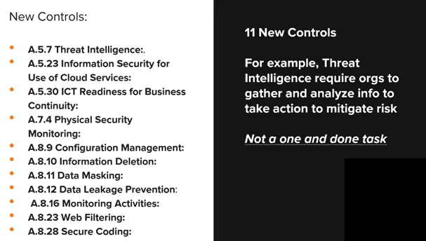

# CISSP

## 01. **Security & Risk Management for CISSP**

#### Key security Concepts

The Key security Concepts. its to Protect the CIA.

The CIA is Evoling using the NIST where its used the IAAA Identification Authentication Authoriation Auditing and Accounting.

Governance And Compliance.

Framework for Business Continuity Planning Steps Creating BCP:

1. Project Initiation
2. Scope
3. Business Impact Analysis
4. Identify Preventative Control
5. 5.Recovery Strategy
6. 6.Designing and Development
7.
   7. Implementation, training, and testing
8. BCP Maintainces

CIA : Its the key for protection.

Confidentiality: Ensures only those with authorization can view data

Integrity: Ensures that data is not modified without authorization

Availability : Ensures data or access is provided in a timely manner to authorized entities (the data should  be  usably and accessablie in timely manner).

IT Security Requirements Enterprise IT (EIT) or traditional IT is the focus of the CISSP Certification and this course. Examples include:

* Protecting the confidentiality of corporate data, training of personnel to reduce risk with human error
* Digital signatures, version control for software, and cryptographic hashes to prevent unauthorized modifications and ensure integrity
* Backup power supplies, and web application firewalls can used to ensure availability.

OT give the better security. which has

Distributed Control System-

* A system of controllers distributed throughout an entire plant area for complex control processes.

SCADA-

* Collects field information and distributes it to a central server

Programmable Logical
\
Controller-
\
A solid-state device
\
designed to perform
\
control functions,
\
especially for industrial
\
processes.

Operation Technology and Information Technology.

OT/ICS and Security Requirements With the increase attention given to OT, rise of the internet in the industrial sector, and now many OT systems are exposed to the same disruptive threats that exist in IT for all internet-connected devices, OT attacks have become massive:

* Intellectual property theft, Distributed Denial of Service (DDoS) botnets, and ransomware attacks
* One such attack was NotPetya 04:23 / 08.07

The Impact NotPetya Cyber Attack of 2017 4. To return to normal business operations, it required 200 Maersk personnel, 400 Deloitte contractors 10 days, working 24/7, to rebuild the Maersk network. Months more were needed to bring about normal software functionality. Maersk was one victim — but handles one fifth of the world's shipping.

NotPetya had an oddity: it
\
didn't actually seem created
\
to make money.
\
Could have been avoided if
\
there had been proper
\
network segmentation, or
\
good vulnerability and patch
\
management.

> **AS THE GRC ANALYST MY JOB IS TO GO ALL IN UNDERSTAND THE ORGANIZATION, VULN , ATTACK VENTORS AND WHAT CONTROLS NEED TO BE IN PLACE TO MINIMUES THE DAMANGE.**

**Evalute and apply GRC.**

Alignment of Security Functions to Business Strategy, Goals, Mission, and Objectives

* Effective security function: aligns with company's business strategy, goals, mission, and business objectives.
* ALL elements must be considered during development, management of organization's information security program and policies When everything is aligned, this is a business enabler.

Security Governance Principles
\
• Security Governance is the collection of
\
practices related to supporting, defining,
\
directing the security efforts of an organization
\
• IT Governance ensures IT resources are aligning
\
to objectives and add value.
\
• Mitigates risk of technologies
\
Proper IT and Security Governance planning
\
ensures they compliment each other

Security Governance Principles

Have to undestand critical process and all for security controls. to make sure all security is accounted.

Applying Security Governance Principles involves:
\
• Aligning organization's security function to company's
\
business strategy, goals, missions, and objectives
\
• Defining, managing organizational processes requiring
\
security oversight (acquisitions, divestitures, etc)
\
• Developing security roles, responsibilities
\
• Identifying a Security Control Framework to align the
\
organization with
\
• Conducting due diligence, due care continuously

Security Governance Planning Security Management Planning must include Long Term, Mid Term, and Short Term planning.

* Long Term: 4+ years, Strategic Goals, Strategic Plans
* Mid Term: 1 year, Tactical Goals, Tactical Plans
* Short Term: Monthly, Quarterly, Operational Goals, Operational Plans

#### Policies,Standard,Procedures and Guildeliness.

<figure><figcaption></figcaption></figure>

Data Policy Data Policy - defines strategic long-term goals for data management across ALL aspects of projects and enterprises. Considerations:

* Cost of providing data vs cost of providing access to data? What data is private and what data is made available to public?
* Understanding liability and how protected the organization is from legal recourse
* Sensitivity analysis - if data is released to public, is there an adverse effect?
* Aligning to laws, regulations, and supporting policies

Mergers and Acquisitions and Security Two separate organizations combining, or taking over a company, creates risk:

* Absorbing entire IT infrastructures: create new attack vectors, "strains resources", increases employee dissatisfaction The organization's security function MUST play a role in M\&A activities. Fix gaps BEFORE connecting T\\

Mergers, Acquisitions and Security What to review BEFORE becoming one company:

* Start with the VAPT and thier vendour and software thier using.
* Infosecurity policies and procedures
* Data assets and relevant regulatory and compliance reqs (GDPR, PCI, HIPAA)
* The personnel policies
* Test results of critical applications ie DAST, SAST)
* Pen Test results of Nework, OS, and application footprints ( remediate critical findings) 3ra party and Open source sottware

Divestitures and Security What to review and assess BEFORE completing a divestiture:

* Identify and classify all assets involved with the divestiture, complete inventory a must
* Decouple impacted systems from remaining infrastructure, divested assets must be removed from "common" infrastructure Review all access permissions Consult legal and compliance teams to following regulatory compliance requirements

#### Governance and Compliance

ORganization roles and responsibilities.

It is everyone's job to keep the organization safe.(everyone is part of security).

* Organizations should define security roles and responsibilities within the information security policy. This definition should align with the roles and responsibilities defined in other organizational policies.

Organizations can include users, full-time and part-time employees, interns, contractors, consultants, vendors, partners, etc. They all must agree to the following:

* Adhere to all information security policies, procedures, standards, and guidelines, plus relevant regulatory and compliance reqs
* Complete all required information security training and awareness activities
* Report suspected security violations or breaches in timely manner

Effective Governance Requires a Top-Down Approach:

* Board of Directors.- executive committee supervising corporation
* Chief Executive Officer (CEO) - highest executive oficer, maximizes companies value
* Chief Information Officer (CIO) - oversees information infrastructure of an organization
* Chief Risk Officer (CRO) - develops, manages risk mitigation programs
* Chief Technology Officer (CTO)-highest technology officer
* Chief Information Security Officer (CISO) - information security programs The Steering Committee is not Board of Directors, champions and oversees initiatives from beginning to end Data Owner - categorization, protection, usage, and quality of one or more data sets
* Data Custodian - has technical control over an information asset All staff is responsible for information security, following company policy

Security control - Firewall can be security controls.

Framework: A security control
&#x20;framework is a "notional
&#x20;construct outlining the
&#x20;organization's approach to
&#x20;security, including a list of
specific security processes,
&#x20;procedures, and solut
ion used by the organization

Security Controls

To assist with meeting legal
\
and regulatory compliance
\
obligations, while also
\
providing a "checklist" to
\
build a security program

<figure><figcaption></figcaption></figure>

ISO 27001 Is ISO 27001 a Standard of Framework? (ITS A FRAMEWORK BASED ON STANDRARD).

* Standards provide detailed structures, including specific metrics, methodologies, and detailed criteria. Frameworks allow flexibility in setting direction without prescribing a specific methodology.
* Now to further confuse things ISO 27001 is a Framework based on an international set of standards&#x20;

9 Steps for ISO 27001
\
Assemble implementation team
\
Develop implementation plan
\
Initiate ISMS (ie PDCA, create ISMS policy, 4 Tier)
\
Define ISMS Scope
\
Identify Security Basleine (ISO Risk Assessment oulines min)
\
Establish Risk Assessment, Identify, Analyse, Evaluate, Select
\
Implement Risk Treatment Plan (build security controls)
\
Measure, monitor, and review
\
Certify ISMS

ISO - Statement of Applicability A document required for ISO 27001 certification.

* Annex A controls that organization determined to be necessary for mitigating information security risk and the Annex A controls that were excluded

What is needed for Statement of Applicability?

* List of controls in Annex A
* List of legal, regulatory, and contractual requirements
* Results from Risk Treatment to justify controls As justification for not applying a control from ISO 27001 Annex A, state "no relevant risks, or legal requirements, demanding the control's implementation".

<figure><figcaption></figcaption></figure>

Compliance

Compliance - the adherence to mandates.
&#x20;Successfully executing all activities,
&#x20;applicable to laws and regulations, industry
&#x20;standards, and contractual obligations.

FISMA - Federal Information  Management Act defines a
&#x20;framework of guidelines and
&#x20;standards to protect US Government

HIPAA - Health Insurance Portabilitiy
&#x20;Accountability Act - protect sensitive
&#x20;patient date from being disclosed

HITECH - Implemented to push
\
electronic health records and
\
technology

Important Standards that Drive Security
\
• Sarbanes Oxley Act 2002 (SOX)- financial
\
regulation of public companies
\
• System and Organization Controls 1 (SOC) -
\
financial reporting
\
• System and Organization Controls 2 (SOC)
\
focuses on security controls. Type I, Type II
\
• System and Organization Controls 3 (SOC)
\
same as SOC 2 but less exhaustive

Important privacy regulations and standards that
\
drive security
\
• OECD Privacy Principles - protect
\
invidivduals, and transborder data flow
\
• EU Data Privacy Directive, US Privacy Laws
\
and "opt in"

Due care:
\
Ensuring that reasonable steps are taken to implement / follow best
\
practices whilst following up Due Diligence with action
\
Due diligence:
\
The continuous monitoring of an organization's practices to ensure
\
they are meeting or exceeding security and regulatory requirement

> The organization has to display due care and due diliegnce for compliance.

Criminal Law

* Criminal Law - proof| beyond reasonable doubt
* Civil (Tort) Law - compensation for wrong doing Administrative - governs administrative agencies of government

LIcensing - Legal Agreements presented to users through cllckwrap or browser wrap agreement

* Click wrap defined by Checkbox or Notice
* Shrink wrap written on outside of software packaging By opening this packaging, purchaser agrees to terms and conditions.

Supporting Documents:

* Business Impact Analysis (BIA) predicts consequences from disruptions
* Interoperability Agreement (IA) how parties will work together, esp 3rd party
* Interconnection Security Agreement (ISA) regulates security relevant aspects
* Memorandum of understanding (MOU) summarize the responsiblities  of parties&#x20;
* Service Level Agreement (SLA) external contract setting expectations
* Operating Level Agreement (OLA) internal contract that supports SLA
* Non-disclosure Agreement (NDA) one party shared confidential info
* Business partnership agreement (BPA) rules for parties imtatiny business

#### Laws, Regulations, and Security Policies

There are laws and regulations that govern handling cyber crimes

* Cybercrimes and Data Breaches Crimes against people Crimes against property
* Crimes against government When Identifying Compliance requirements:
* What jurisdiction has the legal authority to set those requirements. What is permissible and what is not

First laws for information security

* US Computer Fraud and Abuse Act of 1986
* US Economic Espionage Act of 1996 - trade secret theft - Sharon You
* US Child Pornography Prevention Act of 1996 - minors in sex acts
* US Patriot Act of 2001 - Edward Snowden
* US Homeland Security Act of 2002 - post 911

Complaince or privacry as by country

• International Traffic in Arms
\
Regulations (ITAR) - export and
\
import of defense relate items,
\
restricting specific technologies
\
and data resources
\
• Wassenaar Agreement - weapons
\
export controls, regional and intl
\
security

• EU and Member Nations - GDPR &
\
Privacy Shield
\
• Canada - Personal Information
\
Protection and Electronic
\
Documents Act (PIPEDA) -
\
personal data use in business
\
• Personal Data Protection Law -
\
Argentina
\
• Privacy Act - Australia

Computer Fraud and abuse act of 1966

• Oldest and most relevant cybercrime law
\
executed in 1986. Allowed laws to be
\
extended to intangible property such as
\
computer data.
\
• Extended in 1996 to cover "protected
\
computer" (computer used by US Gov or
\
financial institution)
\
• The definition today is broad enough to
\
cover most computers related crimes



***

02.**Asset Security for CISSP**



***

**03 Security Architecture & Engineering for CISSP**



***

04 **Communication & Network Security for CISSP**



***

05 **Identity & Access Management for CISSP**



***

06 **Security Assessment & Testing for CISSP**



***

07 **Security Operations for CISSP**



***

08 **Software Development Security for CISSP**



