# FATPIPE

## TROUBLESHOOTING TIPS


When in doubt, try a restart! I found that a simple device reboot can resolve a surprising number of issues with FatPipe.


<figure><figcaption></figcaption></figure>

## FATPIPE SDWAN: A GAME CHANGER.

### INTRODUCTION

> Fatpipe is a pioneer in hybrid SDWAN technology, built on pateneted innovation that power its SDWAN solutions.

* **MPSEC PROTOCOL**: Provide intelligents WAN Routing with multiple load-balancing algorithums.
* **BLOCKCHAIN LIKE SECURITY**: Has secure data transmission with failover support for VoIP calls, Ensuring no dropped calls.
* **Selective Encryption**: Encrypts selectively data.
* **SmartDNS**: Handles inbound Load Balancing.
* **Dynamic IP Failover**: Automatically Switches IP Address to ensure network reliablity.

## WHAT IS SDWAN ?

Software Defined Wide Area Network is a technology that separates networking hardware from its control mechanisms, offering several advantages.

* Decoupling Hardware from Software: Unlike traditional hardware-based networking, SDWAN separates software from the underlying hardware, allowing for faster service deployment with service chaining.&#x20;
* Separation of Data, Control, and Management Planes: This brings flexibility and precise control over the network, making it easier to manage and customize.&#x20;
* Higher Network SLA: With a transport-independent architecture, SDWAN can aggregate and load balance traffic across different types of connections, providing seamless failover within milliseconds.&#x20;
* Multi-Functionality: A single SDWAN instance, whether on a virtual machine (VM) or dedicated hardware, can perform multiple roles such as a router, firewall, IDS/IPS, load balancer, WAN optimizer, DNS, DHCP, and network management system (NMS).&#x20;

> FatPipe SDWAN specifically builds on these principles with its patented technologies,

SDWAN provides power-packed features while significantly reducing the total cost of ownership (TCO).


In traditional networks without SDWAN, they function much like a postman, receiving packets from one end and delivering them to their destination using routing protocols. However, these networks are unaware of the actual payload or content inside the packets—they don't recognize the applications running behind the data, making them essentially blind to applications.


### SDWAN TYPICAL ARCHITURE

SDWAN changes this by bringing application awareness to the network. It can identify and prioritize the traffic based on the application, ensuring optimized performance, better security, and intelligent routing based on real-time conditions, whether the data is destined for a data center or the cloud.

## BENEFITS OF SDWAN

* Reduces Multiple devices cost by using single device.&#x20;
* Reduce connectivity cost by using single device.&#x20;
* Provides hifgher networks SLA as it reduces point of failures&#x20;
* Improves network security&#x20;
* Enchances network performance&#x20;
* Access traffic and provide QOS&#x20;
* Network management like zero touch&#x20;

## BRING YOUR OWN.

* Fatpipe has full suite of solution to improve the wan edge, whether the end user is looking to simplify wan management, improvements network performace in existing wan fatpipe has its solution&#x20;
* Many sdwan controller is down so the devices is down but that not the case is FatPipe.&#x20;
* Controller is reporting and zero touch provisioning etc.&#x20;

## **FatPipe Value Propositions**

* **SD-WAN Pioneer:** FatPipe is a trailblazer in the SD-WAN industry with a technical advantage over other vendors.
* **Patented Technology:** FatPipe holds 13 critical patents, including 180 technical claims, securing its leadership in the market.
  * Patents are used to protect the hard work and research's and it's an open for every vendor to get deploy in every vendor's network is supported.
* **20 Years of Experience:** With two decades of expertise, FatPipe is highly experienced in the SD-WAN field.
* **RFP Compliant:** FatPipe meets almost all technical criteria in RFPs (Request for Proposals) effortlessly.
* **Top Rated:** FatPipe ranks highly on the Gartner Peer Insights report with a perfect 5-star rating.
* **Industry Leader:** FatPipe is recognized in the leader quadrant of SD-WAN vendors by ‘Software Review.

## FATPIPE PRODUCTS&#x20;

**Product Category: Multi-Path VPN**&#x20;

**Product: MPVPN**&#x20;

**Use Cases:**&#x20;

* Automatic failover for financial transactions, VoIP, video, VPN, and data.&#x20;
* Manages end-to-end latency and jitter.&#x20;
* Features include VPN, branch firewalls, IDS/IPS, web filtering, antivirus, and WAN acceleration.&#x20;
* Advanced routing and automatic failover.&#x20;

**Product Category: WAN Optimization**&#x20;

**Product: WAN Optimization**&#x20;

**Use Case:**&#x20;

* Ideal for areas with limited bandwidth.&#x20;
* Reduces bandwidth needs by 40-90%, depending on data traffic and QoS.&#x20;
* Sat Booster reduces bandwidth for high-latency satellite links (developed with Inmarsat).&#x20;

**Product Category: Single Location/High Density**&#x20;

**Product: WARP/Extreme**&#x20;

**Use Case:**&#x20;

* Supports locations or clusters accessing multiple cloud apps, data centers, or backups.&#x20;
* Inbound load balancing across multiple lines.&#x20;
* Smart DNS enables automatic failover for incoming traffic without DNS propagation delays.&#x20;

**Product Category: Hybrid Cloud**&#x20;

**Product: Cloud Connect**&#x20;

**Use Case:**&#x20;

* Failover for application servers if network or server access fails.&#x20;
* Transfers multi-line VPN traffic between sites in sub-seconds.&#x20;

**Product Category: Orchestrator**&#x20;

**Product: Enterprise View**&#x20;

**Use Case:**&#x20;

* Zero-touch device configuration management.&#x20;
* Monitors device performance.&#x20;
* Ensures data privacy and security; no data passes through the orchestrator.&#x20;
* Can be hosted on-site or in the customer’s network for added privacy.&#x20;

## ABOUT FATPIPE

**FatPipe SDWAN Patents and Contributions:**

* **Patents:** FatPipe's SDWAN patents are held by _FatPipe Networks Private Limited_, an Indian company.
* **Government Endorsement:** GEM (Government e-Marketplace) has provided a final recommendation for FatPipe as an OEM based on their Chennai production facility.

#### What Does FatPipe Do?

**Simple, Efficient, Dynamic, and Adaptable Networking:**\
For nearly 20 years, FatPipe has been a leader in WAN simplification.

#### Key Innovations Over the Years:

* **WAN Routing (1999)**: Pioneering in WAN routing.
* **WAN Path Control (WARP 2001)**: MPVPN launched as the first SDWAN product in 2002.

**Hybrid WAN & Security Innovations:**

* **Multi-Path Security (MPSEC 2003)**: Ensuring secure transmission over multiple WAN paths.
* **SmartDNS (2006)**: Introduced advanced DNS technology for load balancing.
* **Selective Encryption (2008)**: Secure data transmissions based on selective encryption methods.
* **Disparate Networks (2008)**: Innovation in networking across different platforms.
* **Multi-Path WAN Optimization (2009)**: Enhancing WAN performance.

**SDWAN Developments:**

* **Central Manager Orchestrator (2009)**: Centralized management of WAN networks.
* **Multi-Path VoIP (2009)**: Seamless VoIP over multiple WAN paths.
* **Global Policy Template (2012)**: Simplified policy management for global networks.
* **FatPipe Symphony (2015)**: A complete SDWAN solution.

#### Cloud and IoT Innovations:

* **Cloud Connect**: Datacenter-to-device connectivity with public, private, and hybrid cloud deployment.
* **IOT Network**: Seamless failover and management of IoT networks, introduced between 2015-2019.

## **FatPipe MPSEC (Multi-Path Security Transmission)**

FatPipe's patented **MPSEC technology** enhances security by distributing data packets across multiple active internet links, similar to blockchain-level security. This ensures that no single ISP can view the entire data stream, making it difficult to reconstruct the full transmission.

**Key Features of MPSEC:**

1. **Multi-Path Transmission:** Data packets are sent over various routes, maximizing the use of all available bandwidth.
2. **Automatic Failover:** If a link fails, data is automatically rerouted through other paths, ensuring there are no interruptions or dropped packets.
3. **Real-Time SDWAN:** Provides continuous data transmission without the need to restart sessions, even when a failure occurs.
4. **Improved Packet Management:** Data packets are correctly ordered at the receiving end, resolving issues with out-of-order packets often seen in other SDWAN solutions.

**FatPipe Automatic Failover for VoIP and Data in Call Centers**

FatPipe’s patented technology ensures that VoIP and data sessions automatically failover to another line within a sub-second if one link fails, without disconnecting ongoing VoIP calls or data sessions.

**Key Features:**

1. **No Reconnection Needed:** In call center scenarios, if a line fails, VoIP calls continue without interruption, and the customer’s screen remains active, avoiding the need for reconnection.
2. **Sub-Second Failover:** VoIP and data traffic seamlessly transfer to the second line in real-time if the primary connection goes down, ensuring continuous service.
3. **No Bandwidth Waste:** Unlike other solutions that duplicate VoIP packets on both lines, FatPipe sends packets intelligently on both lines without duplication, optimizing bandwidth usage.

FatPipe's technology prevents issues like dropped calls and lost data sessions, common with other systems where users must restart the session after a failover. This is especially beneficial in call centers, where dropped calls can cause major disruptions.

**FatPipe Dynamic/Rotating IP Address Failover Technology**

FatPipe’s **Rotating IP technology** automatically detects changes in IP addresses and reconfigures the SDWAN network in real-time, ensuring seamless connectivity without dropping packets or calls.

**Key Benefits:**

* **Automatic Reconfiguration:** The SDWAN network adapts automatically to IP address changes without interruption.
* **Cost-Efficient Backup:** ISPs can offer lower-cost rotating IP address connections as backup alongside MPLS, even with wireless connections.

This dynamic failover technology provides a reliable solution for maintaining connectivity across rotating IP addresses.

**Hybrid Cloud Connectivity and DR Failover with FatPipe**

FatPipe’s hybrid cloud solutions ensure seamless and secure connectivity to any cloud service such as AWS, Azure, Google Cloud, and IBM. With multi-line, multi-provider options, businesses can connect to hosted applications using any type of internet links.

**Key Features:**

* **Cloud Agnostic:** Compatible with any cloud platform.
* **Flexible Deployment:** Can run as a virtual machine on all major hypervisors.
* **WAN Optimization:** Reduces bandwidth needs, improving performance.
* **Quality of Service (QoS):** Prioritizes real-time applications for better performance.

**Benefits:**

* **Improved Performance:** WAN acceleration across multiple lines delivers faster speeds.
* **High Reliability:** No downtime, even with session interruptions.
* **Data Independence:** WAN caching at the byte level for faster data access.
* **Enhanced Security:** FatPipe’s patented MPVPN ensures secure data transmission.

This solution is ideal for businesses needing secure, high-performance cloud connectivity with robust disaster recovery (DR) capabilities.

***

**Scheduler Feature for Configurations**

**FatPipe’s Simple Calendar-Based Scheduler for Configurations**

FatPipe provides a calendar-based scheduler to manage configurations, including Application QoS settings. This allows you to automate routing and configuration changes based on specific schedules.

**Benefits:**

* **Scheduled Routing Rules:** Automate routing policies for specific times and days.
* **Easy Configuration:** Apply configurations at designated times with a simple calendar-based interface.
* **Rule-Based Routing:** Routing is decided by the order of rules, with higher priority given to earlier rules.

**Use Cases:**

* Prioritize video conferencing (VC) traffic during important sessions.
* Allocate more bandwidth to critical applications during peak periods like month-end.
* Schedule system updates during off-peak hours.

**Hybrid Cloud Management and Disaster Recovery (DR):** FatPipe integrates with hybrid cloud management to provide site load balancing and automatic failover, ensuring business continuity.

**Features Include:**

* **Data Center Failover:** Automatically redirects traffic to backup data centers in case of failure.
* **Server Failover:** Detects server failures and redirects traffic to backup servers.
* **Application Failover:** Redirects failed applications to backup servers.

These features ensure high availability and reliability for your IT infrastructure.

***

**Stateful Firewall**

FatPipe’s stateful firewalls provide secure and restrictive protection for branch offices.

**Inbound Sessions:** All external inbound traffic is blocked unless explicitly allowed by policy rules.

**Outbound Sessions:** Outbound traffic is controlled by policies, providing granular control at Layers 3, 4, and 7.

**Key Features:**

* Restrictive rules can be scheduled and toggled on/off.
* By default, all traffic destined for FatPipe WAN IPs is blocked, except for specific ports like:
  * TCP Port 80 (HTTP)
  * TCP Port 5001 (Remote Management)
  * TCP Port 22 (SSH)
  * UDP Port 500 (VPN)
  * UDP Port 53 (DNS)
  * UDP Port 162 (SNMP)

FatPipe also includes built-in DDoS protection for enhanced security.

***

**SSL VPN**

FatPipe functions as an SSL VPN concentrator, supporting two-factor authentication and offering unlimited user licenses.

***

**FatPipe IPS/IDS**

FatPipe’s Intrusion Prevention and Detection System (IPS/IDS) monitors network traffic to detect and prevent threats.

**Key Features:**

* **Intrusion Detection and Prevention:** Detects and blocks hostile traffic from internal and external sources.
* **Monitoring:** Analyzes user activities and system configurations to prevent intrusions.

***

**Web Filtering**

FatPipe’s Web Filter provides advanced internet monitoring and protection from threats like malware, viruses, and spyware. It also enforces internet usage policies by blocking unwanted websites and file types (e.g., exe, mp3).

**Key Features:**

* Blocks access to inappropriate websites.
* Monitors both HTTP and HTTPS traffic.
* IT managers can block advertisements and specific content to enhance security and user productivity.

## Multiply deployment options.&#x20;

* Ease of use: symphony with orchestrator&#x20;
* FatPipe orchestrated low-touch / zero-touch branch enables enterprises to centrally control their WANs, easily manage branches, and deploy appliances with no IT staff needed at a remote branch. End users can easily migrate to a more optimal hybrid WAN topology for diverse cloud resources.&#x20;

<figure>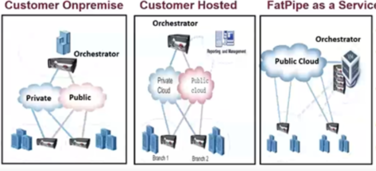<figcaption>
Deployement
</figcaption></figure>

## **FATPIPE HARDWARE APPLIANCES**

FatPipe offers 5 types of hardware appliances in different form factors, each designed for varying site requirements.

#### 1. **Mini Form Factor (STD)**

* **Ideal for:** Sites with less than 300 Mb/s throughput.
* **Interfaces:** 4 Ethernet interfaces.
* **USB Support:** Supports up to 2 USB ports for 4G LTE.
* **Limitations:**
  * No fiber card support.
  * No dual power supply support.
  * Not rack-mounted, VESA mountable.
  * No support for WAN Optimization & NFGW (Next-Gen Firewall) features.

<figure>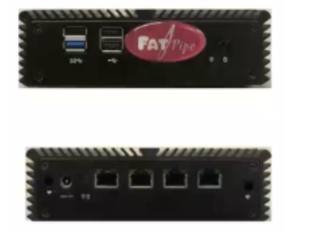<figcaption></figcaption></figure>

#### 2. **SFF (Small Form Factor) – 1U**

* **Ideal for:** Sites with less than 500 Mb/s throughput.
* **Interfaces:** Expandable to 6 Ethernet interfaces.
* **USB Support:** Supports up to 2 USB ports.
* **Limitations:**
  * No fiber card support.
  * No dual power supply support.

<figure>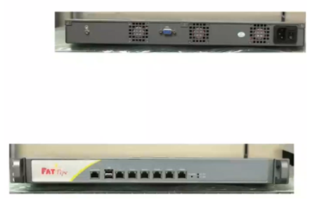<figcaption></figcaption></figure>

#### 3. **High 2U Form Factor**

* **Ideal for:** Sites with more than 1 Gb/s throughput.
* **Interfaces:** Expandable to 16 Ethernet interfaces.
* **USB Support:** Supports up to 2 USB ports.
* **Fiber & Power Supply:** Supports fiber cards and dual power supply.

<figure>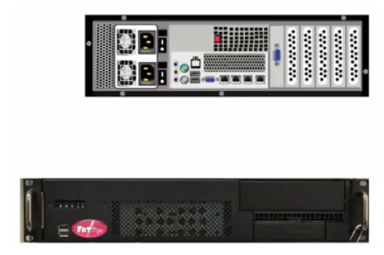<figcaption></figcaption></figure>

#### 4. **High 4U Form Factor**

* **Ideal for:** Sites with more than 1 Gb/s throughput.
* **Interfaces:** Expandable to 16 Ethernet interfaces.
* **USB Support:** Supports up to 2 USB ports.
* **Fiber & Power Supply:** Supports fiber cards and dual power supply.

**Recommendation:** For client throughput exceeding 1 Gb/s, the 4U form factor is recommended due to its higher capacity and aggregation abilities.

<figure>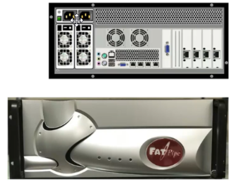<figcaption>
4U Device
</figcaption></figure>

#### 5. **Mini Form Factor (Portable)**

* **Ideal for:** Small sites with less than 300 Mb/s throughput.
* **Interfaces:** 4 Ethernet interfaces.
* **USB Support:** Supports up to 2 USB ports.
* **Limitations:**
  * No fiber card or dual power supply support.
  * Not rack-mountable.

#### Common Features Across FatPipe Appliances:

* All models include **LAN and WAN interfaces** to ensure connectivity, depending on site requirements.

### **FatPipe Default Credentials**

> FatPipe devices come with default LAN and WAN interfaces pre-configured, making initial setup easier.

#### **Common Interface Configurations:**

* **LAN IP Address:** 192.168.0.1
* **WAN 1 IP Address:** 192.168.1.2
* **WAN 2 IP Address:** 192.168.2.2
* **WAN 3 IP Address:** 192.168.3.2

#### **Default Login Credentials:**

* **Username:** Administrator
* **Password:** (Leave blank)

## ROUTE TEST

> The LAN OR WAN Interface link State UP or Down its decided by Route TEST.

> keeps a close eye on all the WAN links you've set up on your device. It regularly checks the connectivity to the specific sites or servers you've specified on the WAN or Internet. Based on the results, it determines the status or availability of each WAN link. FatPipe only sends sessions through the WAN links that are available (Up - Green). If a WAN link goes down (Down - Red), FatPipe will stop sending sessions through it. The Route Test runs every 5 seconds on each WAN link to keep you updated on their status

1. **Periodic WAN Link Checks:**
   * The Route Test module checks the status of all WAN links every 5 seconds.
   * It tests connectivity to user-specified sites or servers on the WAN/Internet.
2. **Link Status Determination:**
   * **UP Status:** If the link is functioning, FatPipe sends out sessions through the available link.
   * **DOWN Status:** If a link is down, sessions are not sent through that link until it comes back up.
3. **Route Test Setup:**
   * FatPipe allows you to specify up to **three user-specified sites** to test for connectivity.
   * These sites can be entered using either a **domain name** or **IP address**.
   * By default, the test uses **port 80 (HTTP)**, but other valid TCP ports can be used for specific tests.

## LOAB BALANCEING

> Basic Rules is set for that algorithums that Fatpipe has to take, differences algorithums used in differenve secnario.

> FatPipe dynamically load balances **outbound** and **inbound** traffic to ensure the highest levels of reliability and redundancy across WAN/Internet connections.

**ROUND ROBIN**

> * Distributes traffic equally across all available WAN links in sequence.
> * its default load balancing algorithm where sessions are transmitted through the lines in rotating order. 1-2-3, 1-2-3, Its used when the ISPs are with same speed.

**RESPONSE TIME**

> * When the ISPs speeds is not the same then this can be used. where the fatpipe choose using the average response time and value and assign session to the lowest response time&#x20;
> * Mostly customer used Response time.
> * Directs traffic to the link with the fastest response time.

**Fastest Route**

> * Whenever the new sesions request comes in, its send on all the WAN LINKs and which ever get the fastest reply the session is sended there.
> * Chooses the quickest route based on overall speed.

**Weighted**

> * It will send sessions based on weights if the WAN 1 Link weight is set to 5 then first 5 session will send from WAN 1 and the WAN 2 is set to 2 then after the 5 Session, 2 session will go from WAN 2.
> * It a 2 way configuration, select the weight and assign weight in WAN interfaces in weight, and can choose primary or backup.(backup will be used when all the primary selected interfaces are down.)
> * &#x20;Distributes traffic based on link capacity, with higher-capacity links handling more traffic.

**Spill Over**

> * One of the WAN 1 is used 90% link utilization, then move to the backup can be done by spill over.
> * Uses the primary link until it reaches capacity, then diverts traffic to secondary links.

**Primary-Backup:** Utilizes the primary link for all traffic, switching to the backup only if the primary fails.

HOW DO I OVERCOME LINK FLAPPING ISSUES ?

In route test of WANs interfaces  there is Link Stabilizing factor up, configure or increase the number then its will wait the number of times route test results and change it to difference interfaces,

## ROUTING ENGINE

> The **Routing Engine** in FATPIPE manages how data packets are routed within the network. It determines the best paths for sending data from your Local Area Network (LAN) to your Wide Area Network (WAN) and vice versa.

### OUTBOUND POLICY

> **Outbound Traffic** refers to any data session that is initiated from the LAN to the WAN. This could be anything from a user accessing the internet or a server in the LAN sending data externally.

#### Default Behavior for Outbound Sessions

FATPIPE’s default behavior for outbound traffic includes the following:

* **Allowing the traffic**: Outbound sessions from the LAN are permitted by default.
* **Load Balancing**: Traffic is distributed across multiple WAN links to optimize performance.
* **Network Address Translation (NAT)**: IP addresses from the LAN are translated to public IP addresses for external communication.

> To change the default behaviour of FATPIPE for OUT we have to create OUTBOUND POLICY RULES.

**Outbound Policy Where Sessions Are Not Load Balanced**

* **Description**: This policy ensures that outbound traffic is not distributed across multiple WAN links.
* **Use Case**: When certain sessions need to use only one WAN link for consistent performance or specific routing requirements.

<figure>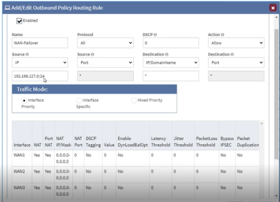<figcaption></figcaption></figure>

**Outbound Policy to Force Sessions Out on a Specific WAN Interface**

* **Description**: This policy forces all outbound traffic to go through a designated WAN interface.
* **Use Case**: Useful when one WAN link provides better speed or reliability for certain types of traffic.

<figure>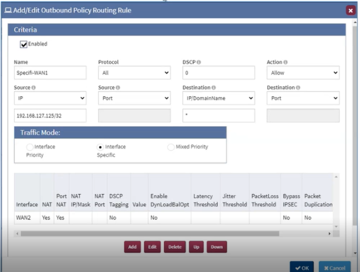<figcaption></figcaption></figure>

**Outbound Policy to Force Sessions Out Using Only Two WAN Links**

* **Description**: This policy restricts outbound traffic to two specific WAN links, even if more are available.
* **Use Case**: Helps with bandwidth management by keeping certain traffic on preferred WAN links while reserving others for backups.

<figure>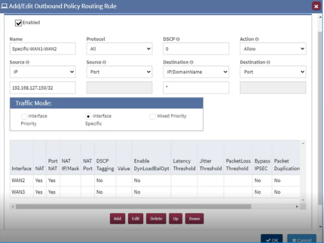<figcaption></figcaption></figure>

Outbound Policy takes precedence over the WAN interface type configured. E.g. Even if WAN2 is setup as Backup link, FatPipe outbound policy engine can still push the session out WAN2.&#x20;

Outbound Policy rules are not applicable for outbound sessions that are initiated from the FatPipe device itself E.g. Route Test Sessions

#### NAT Options for Outbound Traffic:

1. **No NAT**:
   * **Description**: Traffic is sent out without NAT (Network Address Translation).
   * **Use Case**: Typically used when there is no need for IP address modification, such as in networks that already use public IPs.

<figure>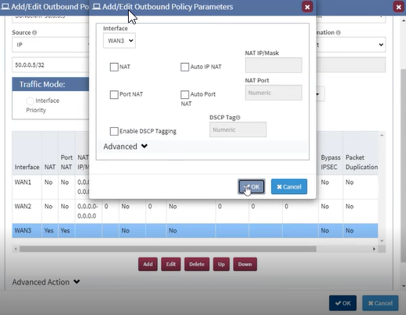<figcaption></figcaption></figure>

**Manual NAT**:

* **Description**: Administrators manually configure which internal IP addresses are mapped to external public IPs.
* **Use Case**: When you need specific internal devices to always use certain external IPs.x\`

<figure>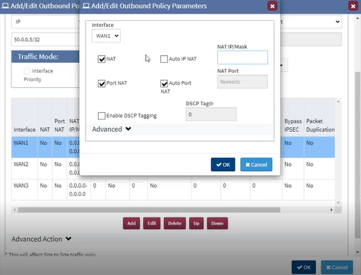<figcaption></figcaption></figure>

**Port NAT (PAT)**:

* **Description**: Multiple internal IP addresses share a single public IP address, with different ports used to distinguish sessions.
* **Use Case**: Ideal when you need to conserve public IP addresses but still support multiple internal devices.

<figure>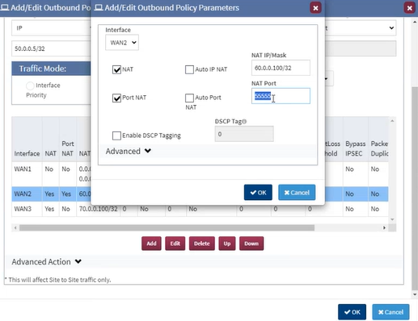<figcaption></figcaption></figure>

### INBOUND POLICY

> Any session which is generated or initialted from WAN to LAN and  trying to come in, FATPIPE to LAN is called INBOUND.

#### Default Behavior for Inbound Sessions

By default, FATPIPE **denies all inbound traffic**. This means no external requests or data can enter the LAN unless explicitly allowed, which provides strong security.

> To change this need to configure  RULE.

**Interface Permit**:

* **Description**: Allows traffic to enter through a specified WAN interface without load balancing.
* **Behavior**: Traffic flows through a defined priority order (e.g., WAN1 first, then WAN2 if WAN1 fails).
* **Use Case**: When you want to ensure certain traffic always uses a specific WAN link for high availability.

> Interface permit will send traffic into the below interface and will not send to load balance like in interface priority it will go first in define WAN 1 - 3 if 1 fail 2 -3 and in interface specific it use all the interface.

**Mixed Priority**:

* **Description**: Combines both priority settings and load balancing for more complex traffic management.
* **Behavior**: WAN links are assigned priority numbers, where lower numbers are processed first. WAN1 and WAN2 might share the same priority for load balancing, while WAN3 has a lower priority, used only when necessary.
* **Use Case**: When you want to balance traffic across primary WAN links but have backups ready in case of failure.

#### NAT Options for Inbound Traffic:

1. **One-to-One NAT**:
   * **Description**: A single public IP address is mapped directly to a single private IP address.
   * **Use Case**: When you need external access to an internal server, for example, mapping a public IP to a web server’s private IP in the LAN.

<figure><figcaption></figcaption></figure>

#### **INBOUND POLICY FOR A SINGLE PUBLIC IP TO NATTED TO BE A PRIVATE IP IN LAN**

<figure>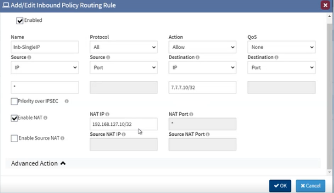<figcaption></figcaption></figure>

**Destination NAT**:

* **Description**: Redirects traffic coming to a specific public IP to a designated private IP.
* **Use Case**: Similar to one-to-one NAT, often used to allow external users to access an internal device or service.

<figure>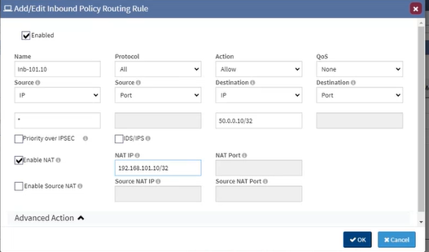<figcaption></figcaption></figure>

**INBOUND POLICY for a single PUBLIC IP to NATTED to a Private IP**

<figure>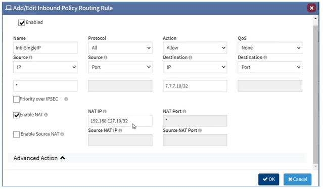<figcaption></figcaption></figure>

**Port NAT (PAT)**:

* **Description**: Maps multiple services on different ports from a single public IP to multiple internal private IP addresses.
* **Use Case**: When you need to provide access to multiple services (e.g., web, FTP, mail) using the same public IP but different ports for each service.

<figure>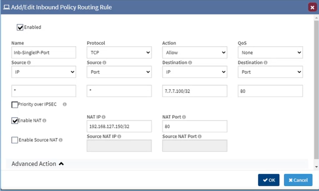<figcaption></figcaption></figure>

PORT NAT

INBOUND POLICY for single Public IP with multiple PORT to be PORT NATTED to multiple IPs in the LAN.

<figure>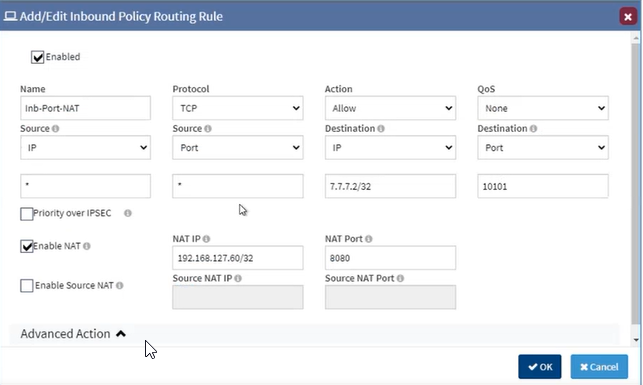<figcaption></figcaption></figure>

**NAT by Firewall**:

* **Description**: NAT operations are handled by an external firewall, bypassing FATPIPE's NAT capabilities.
* **Use Case**: When another device, such as a firewall, is managing the NAT process.

<figure>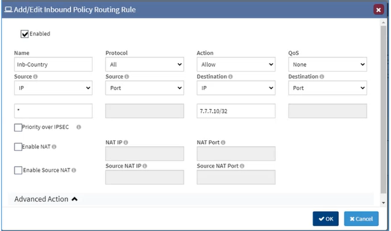<figcaption></figcaption></figure>

## **FATPIPE QOS**

> Fatpipe lauch the QOS featuer of 2006,
>
> QOS provide different level of service to different types of traffic or application based on specific requirements,
>
> QOS ensure that networks can meet the diverse need of different application and users while also maintiaining high levels of performance.

Fatpipe has a dedicate option for QOS

> The main purpose of QOS is to check the packets are transported from source to destination address.
>
> **FatPipe QoS (Quality of Service)** allows you to optimize your network by prioritizing data flow across up to 8 different levels based on factors like priority, latency, and packet loss. With FatPipe QoS, you can allocate bandwidth specifically for business-critical applications, ensuring they receive the minimum bandwidth and quality levels that you define, even during periods of heavy network usage. This guarantees consistent performance for essential services and applications.

<figure>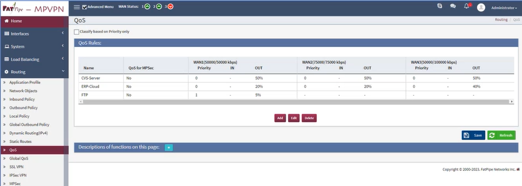<figcaption></figcaption></figure>

### FATPIPE QOS CONFIGURATION

* Configure all WAN interface with Bandwidth details,
* Configure QOS Rules as pre your need like applicaion, servive or user etc.
* Apply the QOS rules to outbound/inbound policy.

Step 1 Configure the upload and download speed for the WAN interfaces.

<figure>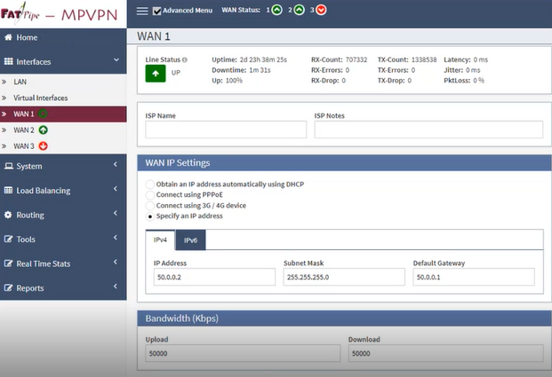<figcaption></figcaption></figure>

Step 2 : Comfigure QOS Rules

> Define QOS Characteristics for a traffic type,
>
> Create a QOS rule >> Click on routing tab in the menu >> click on the QOS tab

<figure>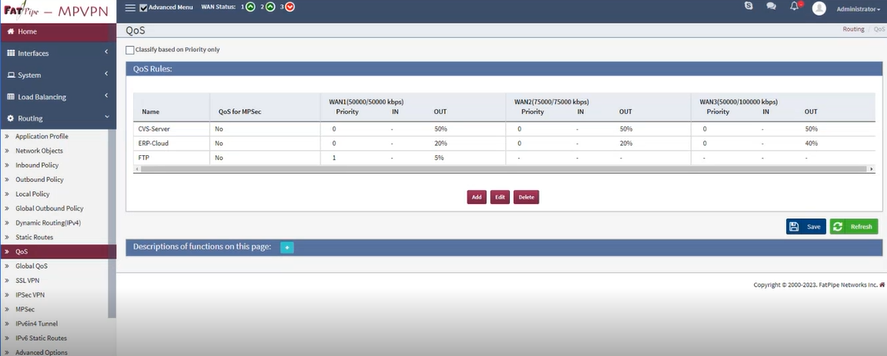<figcaption></figcaption></figure>

#### Configuring the Rule for Outbound Traffic:

1. **Committed Rate**:
   * This is the **minimum guaranteed bandwidth** for outbound traffic. The traffic will only use this bandwidth when the link is up. It ensures a base level of bandwidth that’s always available.
2. **Burst Rate**:
   * This is the **maximum bandwidth** that outbound traffic can use when extra bandwidth is available. It can go up to the maximum speed of the connection, but it must always be **less than or equal to** the committed rate. It represents the highest possible bandwidth that traffic can use in short bursts when needed.

<figure>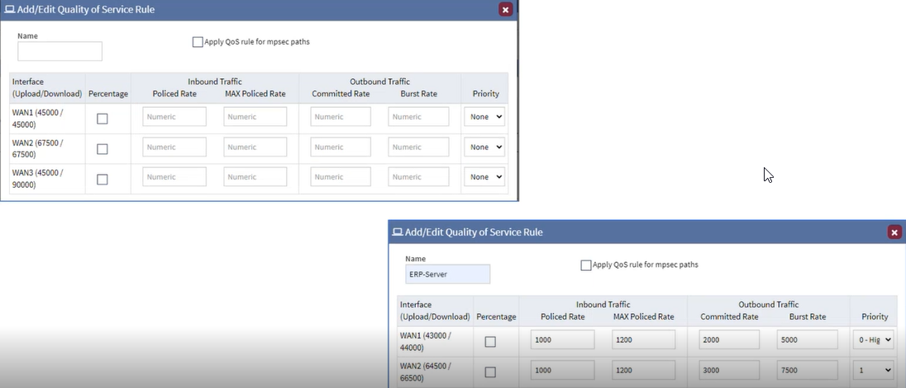<figcaption></figcaption></figure>

#### Configuring the Rule for Inbound Traffic:

1. **Policy Rate**:
   * This is the **guaranteed bandwidth** for inbound traffic. It's the minimum amount of bandwidth that will be reserved for incoming traffic, similar to the committed rate for outbound traffic.
2. **Max Policed Rate**:
   * This is the **maximum limit** for inbound traffic. Any traffic exceeding this limit will be dropped. It acts like the burst rate for outbound traffic but ensures that inbound traffic doesn't go over this set limit.

<figure>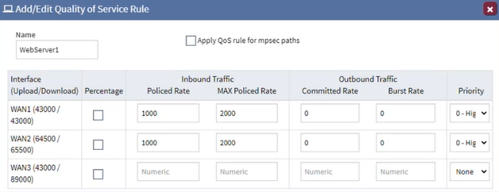<figcaption></figcaption></figure>

Step 3  Apply QOS Rules

<figure>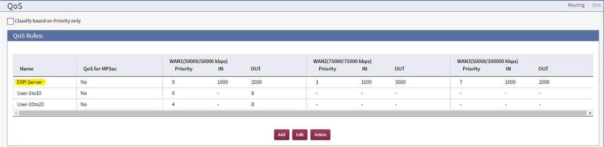<figcaption></figcaption></figure>

> For the **ERP-Server**, we are setting a QoS rule to guarantee **1 Mbps** of outbound traffic on any of the WAN interfaces.

**Advanced Options:**

* Apply the QoS rule by dragging it down in the configuration.
* The rule works in order of priority: if the traffic matches the QoS rule first, it will be applied. After that, other rules, like **NAT** or general traffic to the internet, will take effect.

<figure>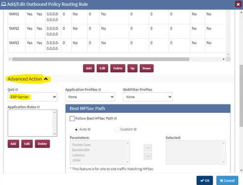<figcaption></figcaption></figure>

Outbound Policy Routing Rules.

<figure>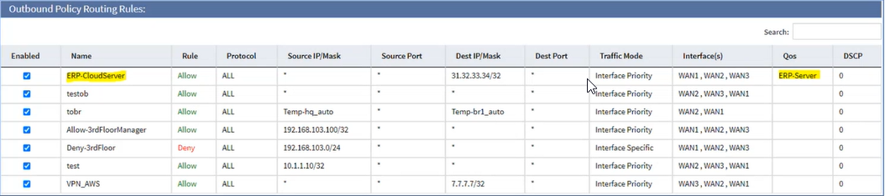<figcaption></figcaption></figure>

## UNIT FAILOVER

> **Unit Failover** is a feature that makes sure your internet connection stays up and running, even if there’s a hardware problem. FatPipe devices can be set up to automatically switch to a backup unit if the main one fails.

* Unit Failover using unmanged switches.

<figure>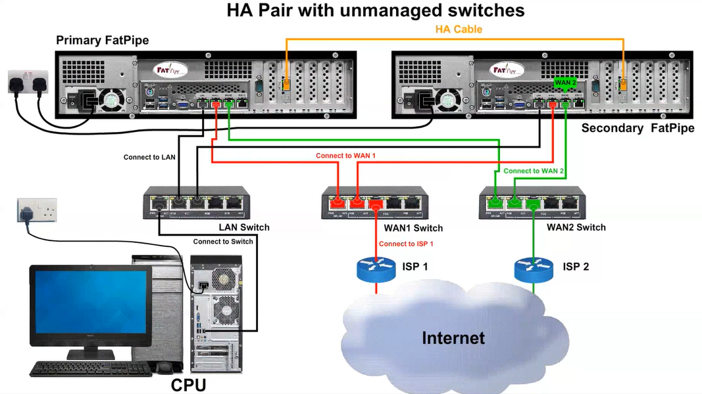<figcaption></figcaption></figure>

* Unit Failover with the Managment Vlans

<figure>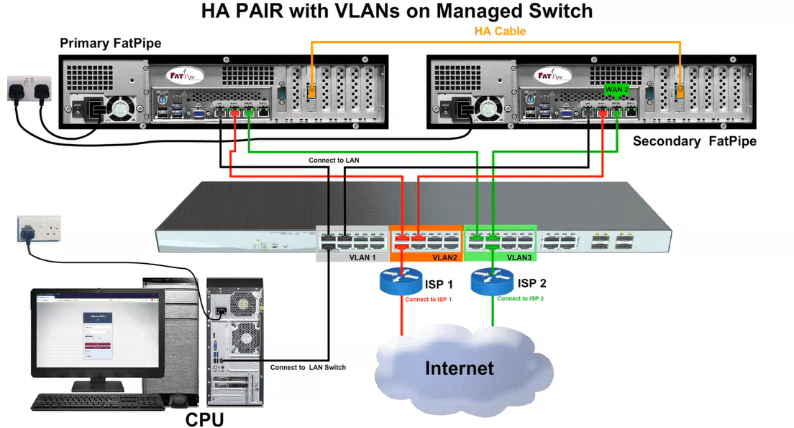<figcaption></figcaption></figure>

### UNIT FAILOVER CONFIG

<figure>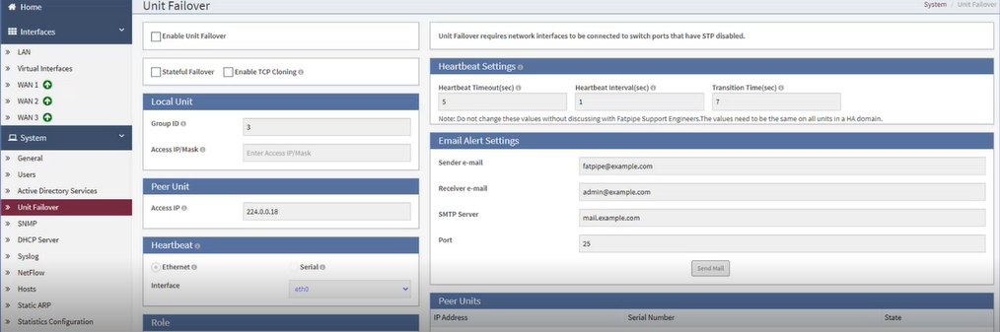<figcaption></figcaption></figure>

* **Enable Unit Failover**:
  * First, go to the GUI and enable "Unit Failover" on both the primary and secondary units.
  * Start by enabling it on the **primary unit**, then power it off.
  * Next, enable it on the **secondary unit**.
  * **Note**: You don't need to copy the primary unit's settings onto the backup unit—just enable the failover option.
* **Local Unit Group ID**:
  * The Local Unit Group ID is a unique identifier for the failover group. Both units in the failover pair must have the same Group ID within the valid range of 1-255 to function correctly
* **Local Unit Access IP/Mask**:
  * This is a private subnet used to access the standby unit when all other IPs are inactive.
* **Peer Unit Access IP Address**:
  * This is the IP address used for "heartbeat" communication between the units.
  * You can either use the LAN interface or a dedicated port for this. It’s best to use a **dedicated port** to avoid issues from LAN traffic causing a failover.
* **Roles**:
  * Each unit has a role—**primary** or **backup**.
  * When both units are powered on, the primary unit becomes active, and the backup goes into standby mode.
* **Force to Standby**:
  * The "Force to Standby" feature allows administrators to manually switch the active unit to standby mode, causing the standby unit to become active. This is useful for maintenance or testing purposes
* Cloning Status:
  * Its clone the active device configuration to the standby device, In the Active device where Force to standby  is done first its trigger cloning then its swap the Box.

<figure>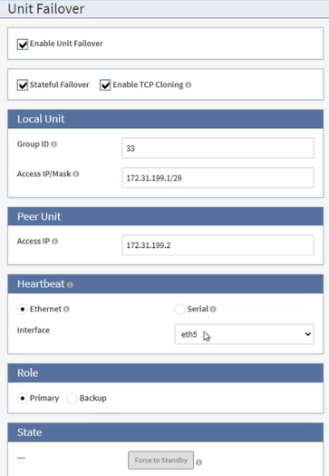<figcaption></figcaption></figure>

### UNIT FAILOVER HOW ITS WORKs

* **Heartbeat Exchange**:
  * All units in the failover group send **heartbeat signals** (using UDP packets on port 5002) to each other to check if they’re active.
  * If the standby unit **stops receiving heartbeats** from the active unit, it becomes the new active unit to avoid losing connectivity.
* **Standby Mode on Boot**:
  * A unit will go into **standby mode** when it starts up if:
    * There’s already an **active unit** in the failover group.
    * All WAN interfaces on the device are **down**.
* **Three Unit States:**
  * **Active**: Device is operational and routing traffic.
  * **Standby**: Device is operational but not routing traffic.
  * **Down**: Device is not operational

### UNIT FAILOVER POINTS TO BE NOTICE

* **Dedicated Ethernet Port**:
  * Always use a dedicated port for the heartbeat exchange in Unit Failover. Both devices need a free port for this.
* **Session Failover Limitations**:
  * Stateful session failover **won't work** with PPPoE or DHCP WAN interfaces.
* **Network Requirements**:
  * Unit Failover requires network interfaces connected to switch ports with **STP disabled**.
* **Don't Change Heartbeat Settings**:
  * Avoid changing the default heartbeat settings without contacting FatPipe support. These settings must match across all units in the failover group.
* **Virtual MAC Addresses**:
  * FatPipe uses **floating virtual MAC addresses**. The active unit gets the virtual MACs assigned to its NICs.
* **Enabling Failover**:
  * After enabling Unit Failover and clicking SAVE, the GUI will **disconnect** because new virtual MAC addresses are assigned to all interfaces (LAN/WAN).
* **Clear ARP Cache**:
  * Clear the ARP cache on the connected devices to avoid connectivity issues with the FatPipe unit UI.

### UNIT FAILOVER SOFTWARE UPGRADE

#### **Upgrading with Secondary Unit Off:**

1. **Power Off the Secondary Unit**:
   * Begin by powering off the secondary unit to avoid interference.
2. **Upgrade the Primary Unit**:
   * Upgrade the **primary unit** to the latest firmware.
3. **Switch Units**:
   * Once the primary is upgraded, **power it down**.
4. **Upgrade the Secondary Unit**:
   * After the primary is powered down, upgrade the **secondary unit** to the latest firmware.

#### **Upgrading without a Maintenance Window (Minimize Downtime):**

1. **Log In to the Primary Unit**:
   * Start by logging into the **primary unit**.
2. **Transfer Firmware to Secondary Unit**:
   * While on the primary unit, log into the secondary unit and **copy the firmware** to the secondary unit.
3. **Upgrade the Secondary Unit First**:
   * Perform the upgrade on the **secondary unit**.
4. **Upgrade the Primary Unit**:
   * Once the secondary is upgraded, return to the primary unit and **upgrade it**.
5. **Downtime Consideration**:
   * This process minimizes downtime by maintaining an active unit during the upgrade, ensuring that there's no complete service interruption.

## FATPIPE IPSEC

> VPN tunnels with any standard IPSec VPN peer. This allows you to establish both site-to-site and remote user VPN tunnels.

#### Encapsulate the traffic before Encryption

> When we encapsulate the traffic before encryption in IPSec, we are essentially wrapping IPv6 packets within IPv4. This allows the IPv6 packet to travel across IPv4 routing infrastructures. The purpose of this is to ensure that IPv6 packets can pass through IPv4 networks, enabling communication between devices that support different IP versions

When the Encapsulate IP is Checked then you have to give the a same subnet IP of P2P which they communicate with each other.

#### NAT-T&#x20;

> It helps create tunnels between VPN devices even if they are behind NAT devices like firewalls. You can set up NAT-T in either "Auto" (automatic) or "Forced" mode. If you choose the Auto mode, the VPN devices will handle the negotiation of NAT-Traversal

#### CONFIGURING IPSEC

* Open GUI, and under routing click VPN.&#x20;
* Click Add button&#x20;
* Give Tunnel name

#### IPSEC PHASE 1 BRANCH 1 CONFIG

<figure>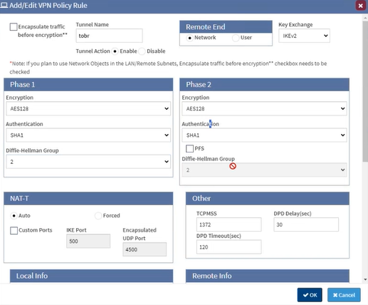<figcaption>
PHASE 1 BRACH 1
</figcaption></figure>

* Click Add in Local Info&#x20;
* Add IP Address/ Mask. This will be the local IP address we are using in Local FatPipe private subnet . Click on OK.&#x20;
* Give Pre-shared key. This key will be used to establish VPN Tunnel with remote site FatPipe device (Ex. Mumbai).&#x20;
* Click Add in Remote Info and give the IP address of the remote site FatPipe private subnet (EX. Mumbai)&#x20;
* External IP and Remote ID should be same&#x20;
* Click OK

IPSEC PHASE 2 BRANCH 1 CONFIG

<figure>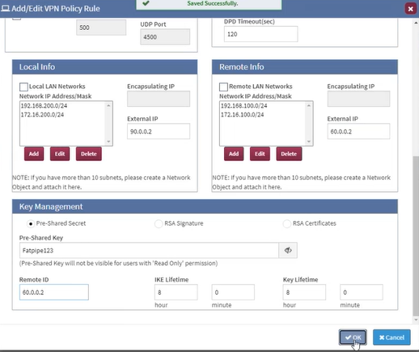<figcaption>
PHASE 2 BRANCH 1
</figcaption></figure>

IPSEC PHASE 1 BRANCH 2

<figure>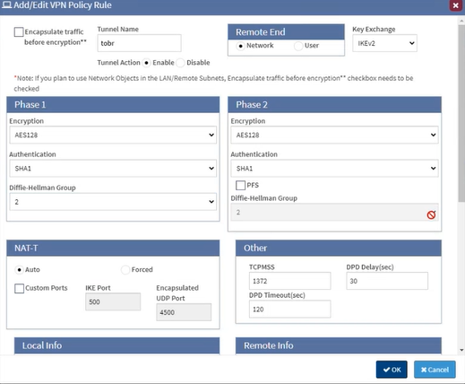<figcaption></figcaption></figure>

IPSEC PHASE 2 BRANCH 2

<figure>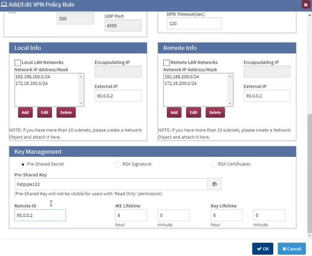<figcaption></figcaption></figure>

## MPSEC

CONFIGURING MPSEC

* Open the GUI and go to Routing.
* Select MPSec.
* Click the Add button.
* Choose the heartbeat type (ICMP is preferred).
* Enter the Remote VPN name and IP.

<figure>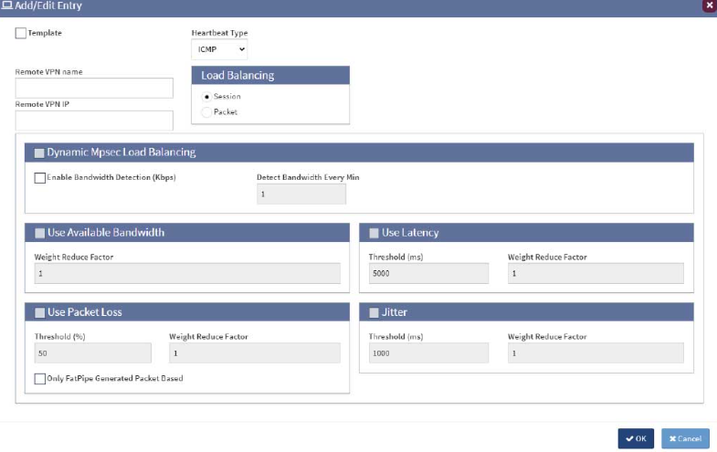<figcaption></figcaption></figure>

* Select the desired WAN for the MPSec path and click Save.
* The path is created.

<figure>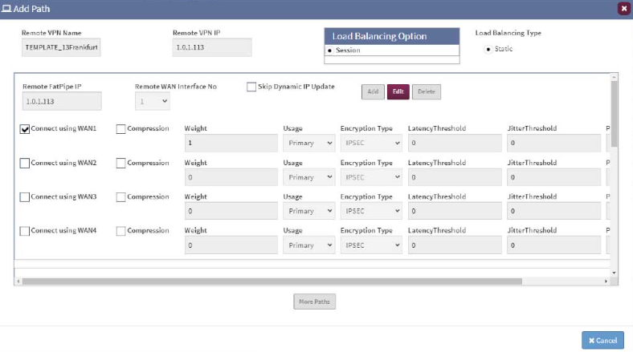<figcaption></figcaption></figure>

## REMOTE ACCESS VPN (SSL VPN)

> VPN (Virtual Private Network) that allows users to securely access a private network and its resources through a web browser. It provides secure remote access to applications and data by encrypting the data transmitted between the user's device and the network. SSL VPN is user-friendly and does not require the installation of specialized client software.

* Go to Routing >> Under SSL >> Enable SSL

<figure>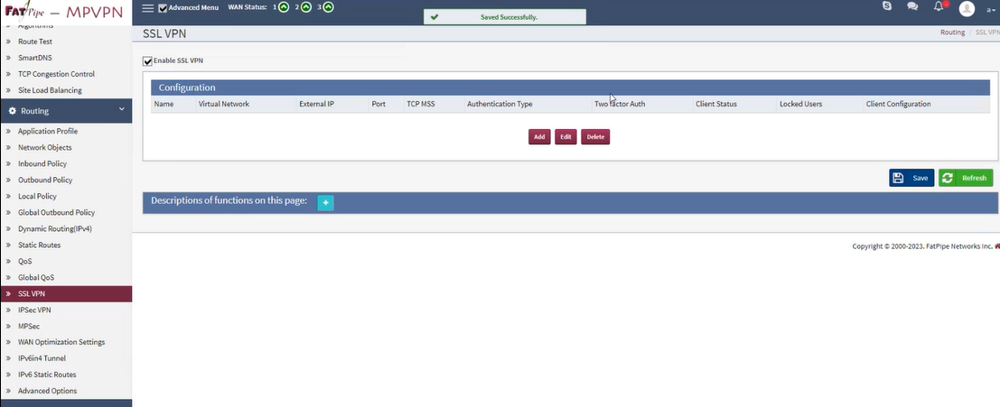<figcaption></figcaption></figure>

* Click on ADD&#x20;
* In the server profile  >> Virtual network >> Give an unique subnet which is not avaiable  in the organizarion before.
* External IP (differe as per the enviroments) the WAN IP of the fatpipe.
* Local LAN Network ( entry the device local LAN IP SUBNETS.&#x20;
* Enable the two factor authenticaation ( Which its generate the QR code whichi use in google authenticator for two factor)

<figure>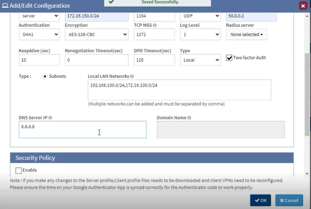<figcaption></figcaption></figure>

* Click on Saved.
* Click on Client configuration.
* Click on the add / edit client profiles

<figure>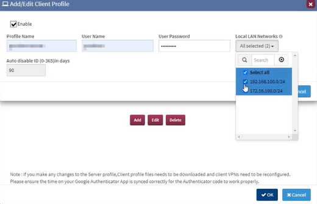<figcaption></figcaption></figure>

* Saved and go again which results in Download File (which is the VPN file from open VPN  WHERE  its can used to connect to the Fatipepe as a remote access VPN)
* ONES download the file and scan the QR with the authenticator and then connected to openvpn with MFA code after the successfly its trun into green.

> There are unto 255 user can be created and its required licenses to enable this feature.

<figure>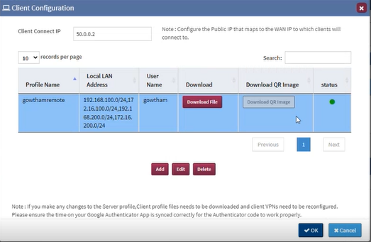<figcaption></figcaption></figure>

## FATPIPE ORCHESTRATOR

> It's a standalone device that can operate on-premises or in a public cloud. Each branch or edge device needs connectivity to the orchestrator via the internet or MPLS.
>
> When a device connects to the network, it authenticates with the orchestrator, downloads the configuration template, and starts routing traffic. The system uses **template-based policy management**, so all configurations are managed through templates.
>
> * **Path Creation**: It can create specific paths between links using **Manage IP Group** >> **Restricted Group** settings.
> * **Auto-Configuration**: The orchestrator is responsible for pulling and pushing templates. For devices designated as controllers, the device type is set to **Controller**, while branch units are set as **HQ Device** types in the orchestrator.


A single orchestrator supports more than 10,000 endpoints. If requirements exceed 10,000 endpoints, multiple orchestrators can be deployed to manage the additional load.


### ORCHESTRATOR LICENSE

1. **Feature**: Orchestration
   * **License**: CM
   * **Function**: Manages devices and configuration templates, including VPN, IPsec, Global Policy, and QoS settings.
2. **Feature**: Enterprise View Reporting
   * **License**: EV
   * **Function**: Collects statistics and generates reports in the Enterprise View option.
3. **Feature**: HQ Device
   * **License**: HUB
   * **Function**: Deployed in the data center (DC) with routing capabilities.
4. **Feature**: Branch Unit
   * **License**: None
   * **Function**: Edge device deployed at branch locations with routing capabilities.

<table><thead><tr><th width="290">Orchestration Device Type</th><th>Details</th></tr></thead><tbody><tr><td>CONTROLLER</td><td>Its ORCH its don't do routing and all and its doen't applied templates.</td></tr><tr><td>HQ</td><td>Its the routing device , download the templates and apply that to the branches device</td></tr><tr><td>BRANCH DEVICE</td><td>its the edge device its get the routing, download the templates and apply them in the device. using key configuration authentication from the orchestratior.</td></tr></tbody></table>

### ORCHESTRATOR FLOW

1. **Branch Units Connect to Orchestrator**:
   * Branch units initiate a connection to the orchestrator.
2. **Orchestrator Validation and Authorization**:
   * The orchestrator validates and authorizes the connecting branch unit.
3. **Network Information Exchange**:
   * Branch units provide their network information to the orchestrator.
4. **Template Request and Provisioning**:
   * Branch units request templates from the orchestrator. The orchestrator provides templates based on the **Auto Configuration >> Key** settings.
5. **Orchestrator Reconfiguration**:
   * The orchestrator reconfigures itself based on updates from branch units when they poll for new information.
6. **Auto Pull-Push Mechanism**:
   * Network configuration is dynamically managed with an auto pull-push process, triggered by the connection status.

### ORCHESTRATOR DEPLOYMENT

* **Large Deployment**:
  * **Orchestrator** and **Enterprise View** are deployed on separate devices.
  * **Hubs** are deployed in the data center or disaster recovery site and are known as **DC Units**.
  * **Edge Devices** are deployed at branch locations and are referred to as **Branch Devices**.
* **Medium and Small Deployment**:
  * **Orchestrator**, **Enterprise View**, and **Hub** are combined into a single device.
  * **Branches** are managed by edge devices known as **Branch Devices**.

### ORCHESTRATOR GROUP AND DEVICE MANAGEMENT

> The branch device will send request for template where the orchestrator validate and verify the device identify which have to checked the authorized box after that the orchestrator will send the configuration templates.

<figure>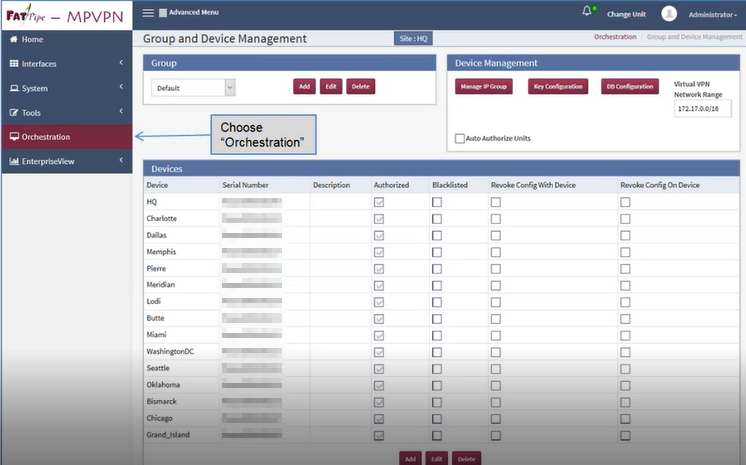<figcaption></figcaption></figure>

### ORCHESTRATOR TEMPLATE

**Template Types**:

* There are three main configurations where templates are created: **IPSEC**, **MPSEC**, and **PRR**.
* These templates are pulled by branch devices or specific devices based on a unique **key** that matches between the orchestrator and the device.

#### **IPSEC VPN Configuration**:

* **Steps**:
  * Go to **IPSEC VPN >> ADD**.
  * Check **Template** and provide a **Name**.
  * Set the **Template Key**: This key should match the key configured in the orchestrator’s auto-configuration settings for the device type "controller."

**Template Management**:

* You can create multiple templates, each with a different key, to assign distinct configurations to different devices.

<figure>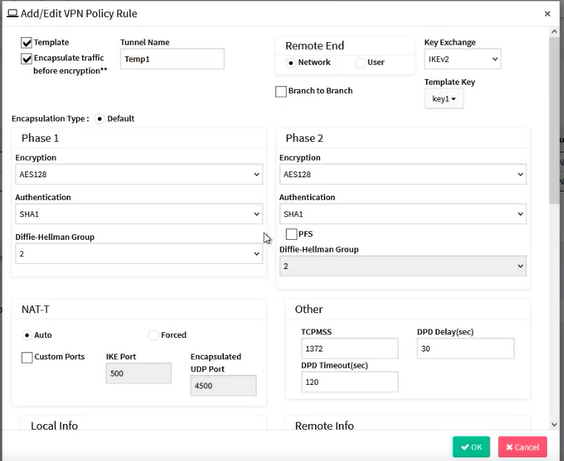<figcaption></figcaption></figure>

**Local and Remote Info**:

* Enable **Local Info** to configure the local LAN network.
* Enable **Remote Info** to configure the remote LAN network.
* If there are multiple devices in the network, the orchestrator will learn the **Local LAN** and **Remote LAN** for these connections.

<figure>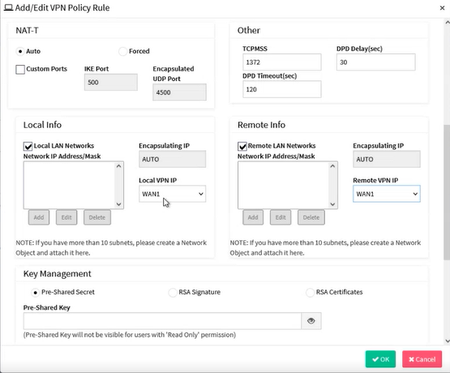<figcaption></figcaption></figure>

**MPSEC Template Configuration**:

* **Steps**:
  * Go to **MPSEC >> ADD** and check **Template**.
  * Configure the **Heartbeat Type** to **ICMP**.
  * Set **Local VPN IP** to the WAN interface.
  * Enter a **Template Name**.
  * Set **Remote VPN IP** for the WAN interface.
  * Enable **Load Balancing** with **Session**.
  * Set **Path Option** to **WAN to WAN**.

<figure>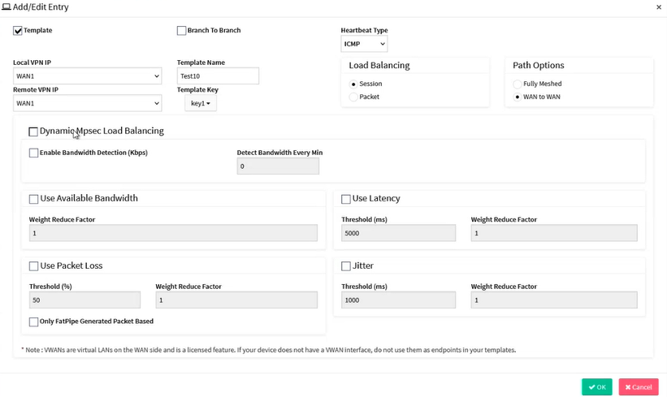<figcaption></figcaption></figure>

#### Branch Side Configuration

1. **Auto-Configuration Setup**:
   * Go to **Auto Configuration**.
   * Select **Device Types >> Branch**.
   * Add the **IP Address** and **Key** for the device.
   * Under **Template**, check **VPN** and **MPSEC** to enable these configurations for the branch device

<figure>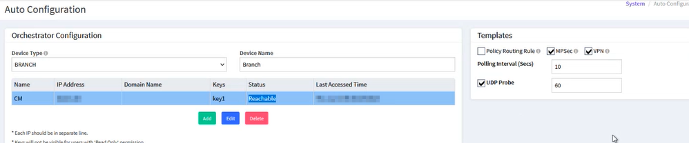<figcaption></figcaption></figure>

#### Global Policy Template

1. **Global Policy Creation**:
   * This policy pushes configurations to all branch or edge devices.
   * Go to **Global Outbound Policy >> ADD** and create the policy based on requirements.

<figure>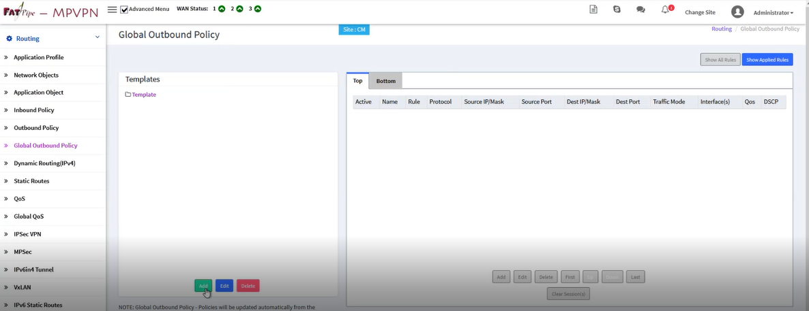<figcaption></figcaption></figure>

* View the policy under **Global Outbound Policy >> Templates** at the bottom of the page.

<figure>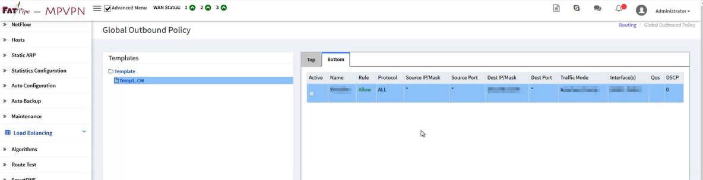<figcaption></figcaption></figure>

## FATPIPE CONFIGURATION

<figure>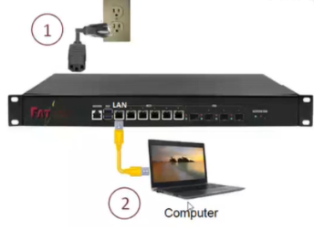<figcaption></figcaption></figure>

1\.   .       **Laptop LAN Configuration**:

* Set your laptop’s LAN IP address to **192.168.0.2**.

* Connect the LAN cable to **LAN port 1** on the FatPipe branch unit.

<figure>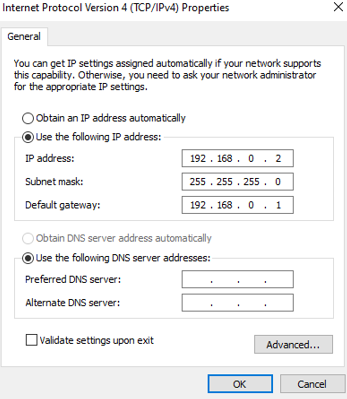<figcaption></figcaption></figure>

2. **Access FatPipe GUI**:

* In a browser, type the FatPipe default IP **192.168.0.1**.
* The FatPipe GUI will open. Enter the username as **Administrator** and leave the password field blank. Hit **Enter**.

<figure>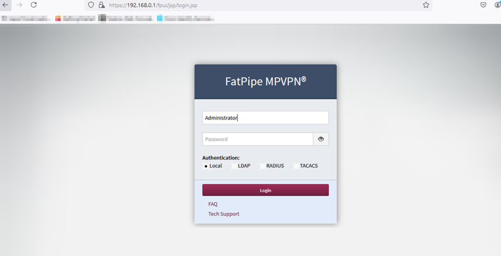<figcaption></figcaption></figure>

3. **Set New Admin Password**:

* The GUI will asked you to set a new password for the **Administrator** account. Set it to **Admin@123** with the privilege set as **administrator**

<figure>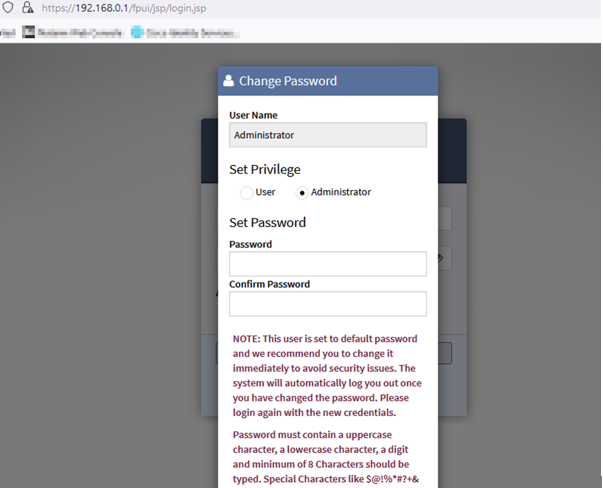<figcaption></figcaption></figure>

4. **Login**:

* Use the newly set **Administrator** username and password to log in

<figure><figcaption></figcaption></figure>

5. **Accept Terms and Conditions**:

* Click **Accept** on the pop-up with terms and conditions.

<figure><figcaption></figcaption></figure>

6. **Advanced Menu and System Info**:

* Enable the **Advanced Menu** option at the top-left of the page.
* Record the **serial number** and **firmware version** for future reference.

<figure><figcaption></figcaption></figure>

<figure><figcaption>
HOME PAGE
</figcaption></figure>

7. **VLAN Configuration**:

* Under **LAN ports**, configure the required VLANs.
* To prevent inter-VLAN communication, select **Exclude from Inter-VLAN Routing**.

<figure><figcaption></figcaption></figure>

8. **Add VLANs**:

* Click **ADD** to configure all required VLANs

<figure><figcaption></figcaption></figure>

Update the default IP according to the branch code.

<figure><figcaption></figcaption></figure>

9. **Save Configuration**:

* Click **Save** at the bottom of the page before moving forward. A "Saved Successfully" message will confirm the changes.

<figure><figcaption></figcaption></figure>

10. **Configure ISP Details**:

* Configure ISP settings on the appropriate **WAN port**.
* Enter the ISP details, update the ISP name, and set the bandwidth.
* Check **Diagnostics** and **Metric** at the bottom of the page and click **Save**.
  * **Example ISPs**:
  * **Pattern of ISP**
  * **ISP 1**&#x20;
  * **ISP 2**&#x20;
  * **ISP 3**&#x20;
* **ISP 1:**&#x20;

<figure><figcaption></figcaption></figure>

* ISP 2

<figure><figcaption></figcaption></figure>

11. **System Settings**:

* Update **Hostname**, **Time Zone**, and **Banner** under the **General** section in the **System** tab.
* Click **Save**

<figure><figcaption></figcaption></figure>

12. **Auto Configuration**:

* In the **System** tab, go to **Auto Configuration** and enter the branch name. Ensure it matches the **General** page.
* Select options for **Policy Routing Rule**, **MPSec**, **VPN**, and **UDP Probe**.
* Set **UDP Probe** to `60`.
* **11\*.1\*\*.1\*\*.9\* (WAN IP).**
* **1\*.1\*\*.\*\*0.2\*\*  (MPLS IP)**

<figure><figcaption></figcaption></figure>

13. **Add Configuration**:

* Click **ADD** and enter the relevant details. Follow the format shown in the example (screenshot reference).
* Click **OK** and then **Save**.

<figure><figcaption></figcaption></figure>

14. **Route Test Configuration**:

* Under **Load Balancing**, configure the **Route Test**.
* Set the **Next Hop IP** for each ISP and select **ICMP** as the test option

<figure><figcaption></figcaption></figure>

Enable **DNS Detection** for each route. And VLAN  Segrigations.

<figure><figcaption></figcaption></figure>

## FatPipe Documents


VPN Configuration User Guide



Installation User Guide


## THANK YOU FOR READING THIS ALL HOPE ITS WOULD BE HELPFULL

