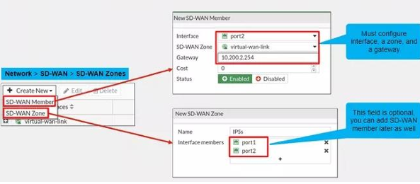

# NSE 7

## SDWAN (Softeware Defined Wide Area Network).

### Introduction&#x20;

Paper Road Map VS GPS Naviagation

> You are traveling from Mumbai to other state where the paper road map was used to find the best route but the real time road closure will not be in paper route. so the driver will be forced to find an alternative route based and the google maps will help to avoid the road closure, accident , travel delays with real time on road that how SDWAN work in the same way SD-WAN help to avoid jitter, packet loss and latency in WAN Network and give the best PATH.

#### SDWAN&#x20;

* The multi connection wan solution is called SDWAN.
* SDWAN is virtual interface of group member (WAN Interface).
* In the Minimum One and Maximum 255 Interfaces can be used in SDWAN.
* Maximum rule are 4000 in SDWAN.
* configuration will be simple because its used one group routes and firewall policies.

#### SDWAN Zones

> SDWAN Zones are group of interfaces and interfaces are like users These zones are used in Policies, Static Routes and SDWAN Rule.

<figure><figcaption></figcaption></figure>

#### SDWAN Member

> The SDWAN member are also called as interfaces, at least one interface are used to run traffic. this member then used in SDWAN rule to forward the traffic.

#### Deployment

> the images used in the writeup is `fortinet-FGT-v7.0.9-build0444` and the fortimanager is `fortinet-FMG-v7.2.0-build124`

