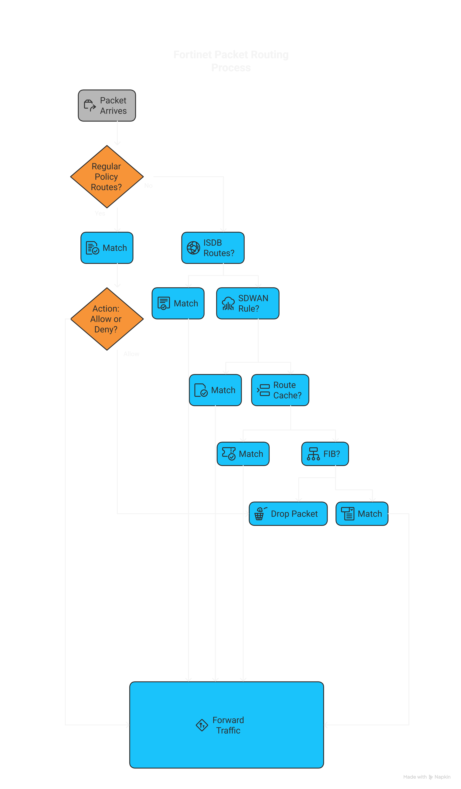

# Policy-Based Routing (PBR)

## Policy-Based Routing (PBR)

### 1. What is PBR?

* **Policy-Based Routing (PBR)** lets you define which path traffic should take based on **policies** instead of just destination.
* Classic routing makes decisions only on the **destination address**.
* PBR can decide routing based on:
  * Source IP / Source Subnet
  * Source Interface
  * Destination IP
  * Protocol
  * Service/Application
* Example: Ensuring **CEO/Manager traffic** always uses the **high-speed ISP link**.

### 2. PBR Decision Process in FortiGate

When a packet enters FortiGate (ingress), the lookup sequence is:

**1. Policy Routes (PBR)**

* First lookup is in **policy routes**.
* If a **match** is found → Action is applied (Forward Traffic or Stop Policy Routing).
* If **no match** → Next step.
* CLI check:

```bash
diagnose firewall proute list
```

**2. ISDB Routes (Internet Service Database)**

* If an ISDB-based route is defined, FortiGate checks it.
* If no match → Next step.

**3. SD-WAN Rules**

* FortiGate checks SD-WAN rules.
* If match → Forward.
* If no match → Next step.

**4. Route Cache**

* Recently used routes stored for faster lookup.
* CLI checks:

```bash
diagnose ip rtcache list
get router info routing-table all
```

**5. FIB (Forwarding Information Base)**

* The **kernel routing table**, containing connected, static, and dynamic routes.
* Final decision point for routing.
* CLI check:

```bash
get router info kernel
```

**If no match in any step → Packet is dropped.**

### 3. Normal Traffic Flow

```
Ingress Packet →
  Policy Routes (PBR) →
  ISDB Routes →
  SD-WAN Rules →
  Route Cache →
  FIB →
  Valid Route Found →
  Policy Lookup →
  Forward Traffic
```

### PBR Traffice Flow

<figure><figcaption></figcaption></figure>

### 4. Key CLI Commands

* **Policy-Based Routes:**

```bash
diagnose firewall proute list
```

* **Route Cache:**

```bash
diagnose ip rtcache list
```

* **All Active Routes:**

```bash
get router info routing-table all
```

* **Active + Inactive Routes:**

```bash
get router info routing-table database
```

* **Forwarding Information Base (FIB):**

```bash
get router info kernel
```

### 5. Policy Routing Lab

**Scenario Setup:**

* WAN1 Gateway: `192.168.1.254` (Port1)
* WAN2 Gateway: `192.168.2.254` (Port2)
* LAN Port: `Port3`, Subnet `10.0.1.0/24`
* HQ-PC1: `10.0.1.1`
* HQ-PC2: `10.0.1.2`
* ECMP Mode: `source-dest-ip-based`

#### Step 1: Change ECMP Mode

```bash
config system settings
set v4-ecmp-mode source-dest-ip-based
end
```

#### Step 2: Create Policy Routes

1. **HQ-PC1 → WAN1**
   * Source: `10.0.1.1`
   * Next-Hop/Gateway: `192.168.1.254`
2. **HQ-PC2 → WAN2**
   * Source: `10.0.1.2`
   * Next-Hop/Gateway: `192.168.2.254`

GUI Path:\
**Network → Policy Routes → Create New**

#### Step 3: Verification

* **Traceroute** from HQ-PC1 → Should exit via WAN1.
* **Traceroute** from HQ-PC2 → Should exit via WAN2.
* **Forwarding Logs** in GUI:
  * **Log & Report → Forward Traffic** shows correct WAN interface per host.
* **CLI Check for Hit Counts:**

```
diagnose firewall proute list
```

#### Step 4: Testing

* Generate traffic from HQ-PC1 → WAN1 counters increase.
* Generate traffic from HQ-PC2 → WAN2 counters increase.
* Session-based verification:

```bash
get system session list
```

### 6. Why Use PBR?

* Ensures **critical users/apps** get routed via the best ISP.
* Provides **granular control** beyond standard routing.
* Works alongside **ECMP and SD-WAN** for flexible WAN design.

