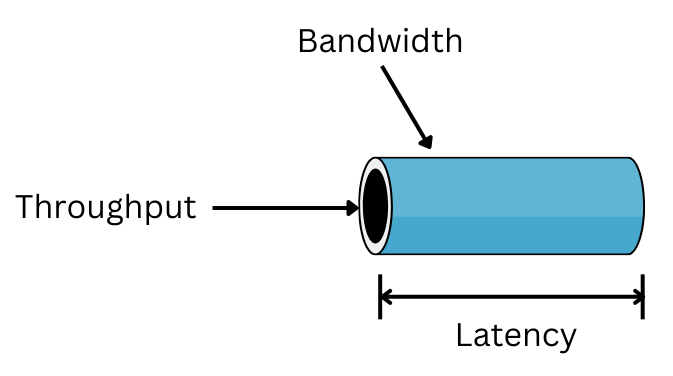
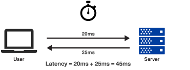
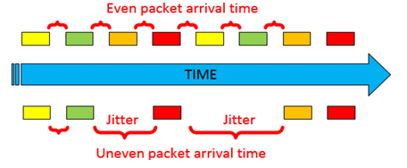

# SD-WAN Terminology

### Bandwidth

* Refers to the **speed or capacity** of a link or interface.
* Measured in **bits per second (bps)**.
* Example: A device capable of **10 Gbps** can transmit 10 billion bits per second.

<figure><figcaption></figcaption></figure>

### Congestion

* Occurs when **traffic flowing through a network exceeds its maximum capacity**.
* Similar to **roads overloaded with cars**.
* Causes **delays/latency** as the interface struggles to handle more traffic than it can process.

### Delay (Latency)

* The **time it takes for a packet to travel** from source to destination.
* Types of Delay:
  * **Transmission Delay** – Time to put data onto the transmission link.
  * **Propagation Delay** – Time for a bit to physically travel across the medium.
  * **Queuing Delay** – Time packets spend waiting in a queue.
  * **Processing Delay** – Time required by a processor to handle the packet.

<figure><figcaption></figcaption></figure>

### Jitter

* **Variation in the delay** of received packets.
* Caused by congestion, queuing issues, or configuration errors.
* Impacts **real-time/interactive traffic** (e.g., voice, video).

<figure><figcaption></figcaption></figure>

### Packet Loss

* Happens when **packets fail to reach their destination**.
* Causes:
  * Transmission errors (common in wireless networks).
  * Network congestion (routers/switches dropping packets).
* Measured as a **percentage of packets lost vs. packets sent**.

### SLA (Service Level Agreement) in FortiGate

* In SD-WAN, SLA is like a **health checker** for network links.
* Uses **active traffic monitoring (IP SLA)** to measure:
  1. **Latency** – Delay of packet travel.
  2. **Jitter** – Stability of delay.
  3. **Packet Loss** – Percentage of lost packets.

#### SLA Targets

* Defines **quality thresholds** a link must meet to remain usable.
* If thresholds are exceeded → FortiGate reroutes traffic to another link.

| Metric      | Threshold Range   | Default Value |
| ----------- | ----------------- | ------------- |
| Latency     | 0 – 10,000,000 ms | 5 ms          |
| Jitter      | 0 – 10,000,000 ms | 5 ms          |
| Packet Loss | 0 – 100 %         | 0 %           |

#### Link Status

* Determines how often FortiGate checks link health.
* **Failover/restore timers** prevent constant switching (**flapping**).

#### Link Health Monitor

* A **watchdog mechanism** to detect degraded or failed routes.
* Ensures FortiGate reroutes traffic if a link or router becomes unhealthy.

