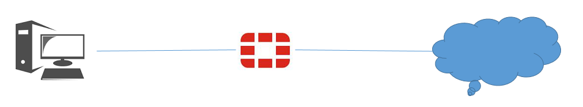
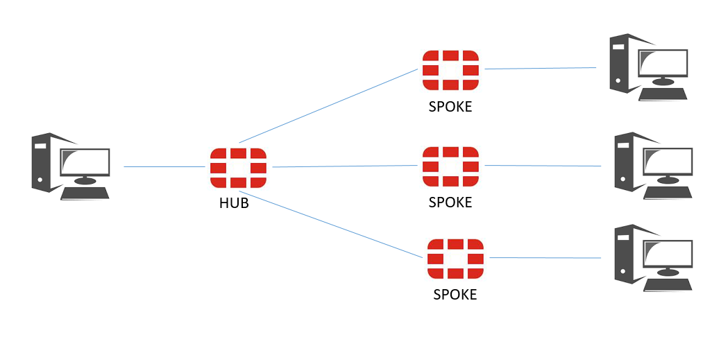
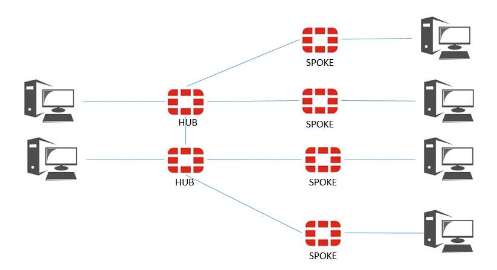

# SDWAN Principle

SDWAN used the **Five Pillar Approach.**

#### **1. Underlay**

* The **physical WAN links** (Broadband, MPLS, LTE, etc.).
* This is the _foundation transport_.

> _Choose the WAN link(s) you want to use._

#### **2. Overlay**

* The **logical VPN tunnels** built over the underlay.
* Supports **ADVPN** for dynamic connections.

> &#x20;_Choose the topology to interconnect sites (hub-spoke, full mesh, etc.)._

#### **3. Routing**

* Uses both **traditional routing table** + **SD-WAN rules**.
* Can steer traffic by **destination, application, SLA (latency/jitter/loss), etc.**
* ECMP helps balance paths.

> &#x20;_Choose how traffic is routed between sites._

#### **4. Security**

* SD-WAN rules can enforce **firewall/security policies**.
* Ensures paths are not just optimized but also protected.

> &#x20;_Choose how to secure the path._

#### **5. SD-WAN (Smart Control Plane)**

* **SD-WAN Zone:** Groups WAN member interfaces, used in policies.
* **SD-WAN Members:** Physical interfaces part of SD-WAN.
* **SLA:** Health-checks (latency, jitter, packet loss). Removes bad links from routing.
* **SD-WAN Rule (Service):** Decides outgoing interface/path based on policy (App, User, SLA, etc.)

> _Choose the best path dynamically for each application/traffic._

&#x20;**In short:**

* **Underlay = physical links**
* **Overlay = VPN tunnels**
* **Routing = how to reach destinations**
* **Security = protect the traffic**
* **SD-WAN = smart brain that monitors SLA, applies rules, and picks best path**

#### SDWAN Architecture

Single Device Desgin.

<figure><figcaption></figcaption></figure>

Single Hub Device.

* its and multi site hub and spoke environment. which interconnected by IPSEC overlay. forming hub and spoke topology.

<figure><figcaption></figcaption></figure>

Dual Hub Design

* the its same as single hub but as the infra is large its require secondary HUB as a backup.

<figure><figcaption></figcaption></figure>

