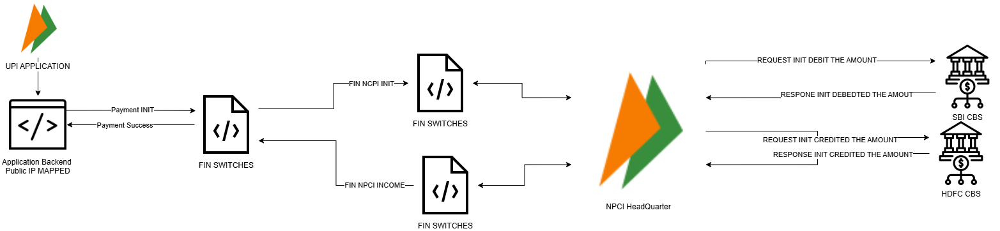

# NPCI

## NPCI

### Who is NPCI first?

**NPCI (National Payments Corporation of India)** runs systems like:

* UPI
* IMPS
* RuPay
* NETC (FASTag)
* AEPS

NPCI sends **official instructions** to banks and service providers. These instructions are called **Circulars**.

***

### What is **OC** in NPCI?

#### OC = **Operational Circular**

**Most important and most used circular**

#### Meaning (very simple):

> OC tells banks **HOW to operate the system day-to-day**

#### Examples of what OC contains:

* Settlement timings
* File formats
* Cut-off times
* Reconciliation process
* Dispute handling
* Technical & operational rules

&#x20;The document you shared is a **UPI OC (Operational Circular)**.

#### Example:

> “Settlement will happen in DC1 and DC2 only”\
> → This is an **Operational rule**, so it comes under **OC**

***

### What is **UC** in NPCI?

#### UC = **User Circular**

&#x20;Focused on **customer / end-user impact**

#### Meaning:

> UC explains **rules that affect customers directly**

#### Examples:

* Chargeback timelines
* Customer liability
* Failed transaction handling
* Refund timelines
* Fraud responsibility

&#x20;UC is **less technical**, more **policy + customer focused**

***

### OC vs UC (Easy Table)

| Point     | OC                       | UC                       |
| --------- | ------------------------ | ------------------------ |
| Full form | Operational Circular     | User Circular            |
| Audience  | Banks, PSPs, Vendors     | Banks, Customers         |
| Nature    | Technical & operational  | Policy & customer impact |
| Example   | Settlement cycle changes | Refund timeline rules    |

***

### &#x20;What is **URCS**?

#### URCS = **UPI Rules & Compliance Specification**

&#x20;Think of URCS as the **rulebook**

#### Meaning:

> URCS defines **what is allowed and what is mandatory** in UPI

#### Contains:

* Compliance rules
* Do’s & Don’ts
* Penalties
* Mandatory controls
* Audit requirements

📌 OCs and UCs **refer to URCS rules**

***

### What is **Advisory**?

#### Advisory = **Strong recommendation**

&#x20;Not always a strict rule, but **expected to be followed**

#### Example:

* Improve monitoring
* Strengthen security
* Improve RCA process

&#x20;RBI audits still expect compliance with Advisories

***

### &#x20;What is **Annexure**?

#### Annexure = **Attachment / detailed table**

&#x20;Used to give:

* Timings
* Formats
* Examples
* File names

&#x20;In your document, **Annexure-1** shows:

* Adjustment files
* Timings
* Settlement status

***

### &#x20;What is **Addendum**?

#### Addendum = **Update to old circular**

It **modifies or extends** an earlier circular

&#x20;Your document is:

> **Addendum to Segregation of UPI Settlement Cycles**

Meaning:

* Old rule existed
* NPCI updated timelines & process

***

### &#x20;What is **DC (DC1 / DC2)**?

#### DC = **Designated Cycle**

&#x20;Special settlement cycles

| DC  | Meaning               |
| --- | --------------------- |
| DC1 | 11th settlement cycle |
| DC2 | 12th settlement cycle |

Used only for:

* Auth settlement
* Dispute adjustments

### &#x20;How all this fits together (BIG PICTURE)

```
URCS (Rulebook)
   ↓
OC (How to operate)
   ↓
UC (Customer impact)
   ↓
Advisory (Best practices)
   ↓
Annexure (Details)
```

***

### One-line beginner summary&#x20;

* **OC** → How banks should operate UPI
* **UC** → How customers are affected
* **URCS** → UPI rulebook
* **Advisory** → Strong guidance
* **Annexure** → Detailed tables
* **DC1/DC2** → Special settlement cycles

### NPCI Directive

Directive 10 (BCP/DR Drill).

> The directive 10 Says every banks/Switch Provide/Vendous of financial should conducted the BCP and DR Drill report.

Directive 12 (support for new rupay contactless card).

> The transcation without the network like metro, tolls which is the offline balances with add/topup .

<figure><figcaption></figcaption></figure>

Directive 17 (Virtual Account for Offline Balance Management)

> this is the part of rupay contactless offline wallet management where the banks must create a seprate backend account to maintain and tracks the offline balance stored on the card.

Circular UPI OC 222A Segregation of settlement Auth & Dispute 10 to 13 Cycles



#### UPI Transaction

When you send money using Google Pay / PhonePe / BHIM, that is a **UPI transaction**.

Example:\
You send ₹500 to a friend → transaction happens instantly.

***

#### &#x20;Settlement (very simple meaning)

Settlement means **actual money movement between banks**.

Even though money looks instant to you, **banks settle money multiple times a day** in batches called **settlement cycles**.

***

#### &#x20;Two types of transactions

NPCI has divided UPI transactions into **two categories**:

| Type                     | Meaning                                      |
| ------------------------ | -------------------------------------------- |
| **Auth (Authorisation)** | Successful UPI payments                      |
| **Dispute**              | Failed, reversed, or complained transactions |

***

### What problem NPCI is solving?

Earlier:

* **Auth transactions**
* **Dispute transactions**

Both were getting mixed in **many settlement cycles (1 to 10)**\
&#x20;This caused **confusion, delay, and reconciliation issues**

***

### What NPCI decided (MAIN CHANGE)

#### &#x20;BIG CHANGE

NPCI said:

> From now on, **Auth and Dispute settlements will be handled separately**

And they will be processed **ONLY in special cycles**:

| Cycle          | Name |
| -------------- | ---- |
| **11th cycle** | DC1  |
| **12th cycle** | DC2  |

Cycles **1 to 10 will NOT be used anymore for adjustments**

### Important dates (remember this)

| Event                    | Date              |
| ------------------------ | ----------------- |
| Original go-live         | 3 Nov 2025        |
| **Final effective date** | ✅ **15 Dec 2025** |

So from **15 December 2025**, new rules apply.

### What exactly happens after 15 Dec 2025?

#### Adjustment reports timing (VERY IMPORTANT)

NPCI will send **only 3 adjustment reports per day**&#x20;

| Adjustment File    | Time          | Meaning             |
| ------------------ | ------------- | ------------------- |
| **1st Adjustment** | 00:00 – 10:00 | Dispute report only |
| **2nd Adjustment** | 00:00 – 16:00 | DC1 settlement      |
| **3rd Adjustment** | 16:00 – 00:00 | DC2 settlement      |

(Source: Annexure-1, page 2 of circular) Circular UPI OC 222A Segregatio…

***

#### &#x20;What is settled and what is not?

| File                            | Settlement happens? |
| ------------------------------- | ------------------- |
| 1st Adjustment (Dispute Report) |  No                 |
| DC1 (11th cycle)                |  Yes                |
| DC2 (12th cycle)                |  Yes                |

***

### Simple real-life example&#x20;

#### Case 1: Normal payment

* You pay ₹1,000
* Transaction successful
* &#x20;It will be **settled in DC1 or DC2**

***

#### Case 2: Failed payment / complaint

* Money debited but not credited
* Bank raises dispute
* Handled **separately**
* &#x20;Adjusted only in **DC1 / DC2**
* &#x20;NOT in cycles 1–10


## UPI&#x20;

> [https://medium.com/@avinashkariya05910/deep-dive-system-design-of-upi-unified-payments-interface-eff3b0334b0d](https://medium.com/@avinashkariya05910/deep-dive-system-design-of-upi-unified-payments-interface-eff3b0334b0d)


UPI Architecures

<figure><figcaption></figcaption></figure>

